# princeton

### A guitar amp simulator, pedalboard and looper for Monome Norns

[](https://www.youtube.com/watch?v=VqkFejb8owY)

princeton is a guitar amp, pedalboard, and looper for Monome Norns. The amp sits in the middle: a small American combo from the early 1960s, recreated in code. Around it, four pedals before the input, bias tremolo and spring reverb after, and a 60-second stereo looper riding between them. What you loop washes through the same reverb as the live signal.

Plug a guitar into the left input. No preamp or interface required.

The looper carries the script. Six storage media (BBD, Cassette, CD, Chip, Tape, Vinyl) colour the loop. Imprint sets how much of that colour gets baked in the moment you record; Wear sets how much further the loop erodes on every pass. Four playback modes (Overdub, Overwrite, Sample, Resample) and four direction modes (Forward, Reverse, Pendulum, Random) sit underneath. Tremolo and reverb stay on. The amp stays clean unless you push it past Volume 5.5. For harder distortion, reach for Push or Distort up the chain.

## What it does

**Loop.** A 60-second stereo buffer between tremolo and reverb, so anything you record sits in the same spring tank as the live string. Medium picks the storage type the loop pretends to be: BBD darkens and saturates, Cassette wobbles and crinkles, CD plays clean until it skips and stutters, Chip quantises and aliases like an early sampler, Tape softens and drifts, Vinyl crackles and wobbles over a gentle high-frequency rolloff. Imprint controls how strongly the medium colours the signal as it lands in the buffer (the first repeat already sounds like the medium). Wear controls how much further the medium erodes the loop on every subsequent pass; at 0 the loop is stable, at higher values it ages over time. Direction can run forward, reverse, pendulum, or random. Mode covers Overdub (layer), Overwrite (replace), Sample (one-shot, K2 retriggers), and Resample (record the loop output back into the buffer, including its own ageing). Speed transposes by an octave in either direction in Steps mode, or sweeps continuously in Smooth mode. **Undo** takes back the last overdub: hold K2 for two seconds on Amp or Loop and the loop returns to how it sounded before that dub. One level deep; a second Undo without a new dub does nothing, and Undo during a running dub ends it and restores the state before it. The switch back is sample-exact and covered by a fade of a few milliseconds, so it does not click. The recording itself is taken back with Clear. The looper keeps running while you open the tuner or pedalboard.

**Route.** The first device of the chain decides what goes in: the guitar in Mono, both inputs in Stereo, or a voice. It also sets Input Trim and the two fx sends.

**Voices.** princeton can be its own sound source. Any installed voice appears in Route's input list; pick one and it replaces the guitar and runs through the whole chain, pedals, amp, loop and all, played from any MIDI keyboard. **Keys** sits between the keyboard and the voice: Hold latches a chord, Retrig restrikes it on the clock, Octaves climbs an octave per strike.

**Cut.** An optional noise gate at the very front of the chain, before the pedals, bypassed by default. Classic noise suppression between notes, but the wide parameter ranges also make it a creative tool: a long Attack turns it into a slow-gear swell that fades in every note, a fast Attack and Release with a short Hold give percussive chopping, and a partial Range ducks quiet passages instead of silencing them. Because every gate parameter is a modulation target, an LFO on Threshold synced to the clock turns it into a rhythmic, tremolo-style gate. Detection runs in Peak mode for a snappy response or RMS for a smoother contour, and Margin (a hysteresis control) sets how far the signal has to fall back below Threshold before the gate closes.

**Pedalboard.** Four effects sit between the input and the amp, paired by character: Push and Distort handle gain, Warp and Repeat handle modulation. Each is independently bypassable. Open the pedalboard view from any other view with K2 (gain pair) or K3 (modulation pair) held; the pedal you are working on shows its lit knob, and its name stands in the strip on the left.

**Amp.** A small American combo from the early 1960s. Volume below 3.5 stays clean; past 5.5 it begins to break up, so single-coils clip lightly at the default when you dig in. Bass and Treble at 5 give the open Fender voice; below 3 they cut. The mid-scoop in the tone stack is fixed. With NamAmp installed, the Amp can instead run a Neural Amp Modeler capture (`.nam` file) of any amp you like, with Mid and Mid Freq added to its tone controls.

**Tremolo.** Bias-style amplitude modulation, always available at the output of the amp. Intensity defaults to 0, so nothing is happening until you turn it up. Up to 15 % the dry signal fades while the tremolo blends in; past 15 % it's pure tremolo with rising depth. Peaks stay at full amplitude. Speed defaults to 2.5 Hz and can sync to the Norns clock.

**Hold.** Two granular momentary freezes in parallel, sitting between Tremolo and Loop and capturing the fully amped, post-tremolo tone. The pads feed the looper as well, so recording or overdubbing while a pad is held prints it into the loop; a loop that is only playing leaves it out. Switch one to Active and it grabs the last second or so you played and sustains it as a granular pad while the live signal keeps passing through underneath, so you can play over the held sound. Gain drives the pad into a soft saturation for body, Level sets its place in the mix, Size sets grain length, Density how thickly the grains overlap, Spread scatters their onsets in time, and Shape swaps the grain window for a softer, swelling, plucked or flatter character. Pitch transposes the pad by up to two octaves either way, and Pitch Mix decides how much of it is shifted. The pad fades in over Rise and out over Fall; re-engaging during a Fall crossfades the old freeze into the new one, and Recapture grabs a fresh freeze without letting go first. Movement lets Size, Density and Spread drift slowly around their settings so a long pad keeps breathing. Run both instances at once, with different Size, Shape or Pitch, to layer two complementary freezes.

**Spring reverb.** Applied to the full stereo mix, live signal and loop together. Amount sets both send level and decay; Length adjusts decay independently if you want longer wash without more signal in the tank. Low Shelf and High Shelf colour the wet path. Dwell and Drip give it the character of a Fender tank. At the default 10 % Amount the spring tank sits behind the signal; turn it up for the long shimmer.

**Cab & Mic.** A 10" Jensen-style cabinet model with three mic positions (Center, Middle, Edge). Or bypass cabinet processing entirely for a raw DI tone or to feed an external cab.

**Tape.** A tape machine as the last stage, after the cabinet: tape speed, saturation, bias, hiss, wow and flutter, magnetic density, head azimuth, and a tape stop and start on K2. Active by default and level-matched, so it colours the whole mix without making it louder.

**Build.** After the tape, a stereo pair of digital delay lines whose lengths stand in a ratio, the second one optionally reversed. Long times run at lower sample rate and bit depth, like an early digital delay; repeats can jump an octave, smear into a haze, or freeze into a loop. Bypassed by default.

**Mesmerize.** The very last stage: a large, slowly moving reverb tank for washes far beyond the spring. Freeze holds the tail indefinitely. Bypassed by default.

**Output.** Stereo throughout the post-amp section. Tremolo alternates between L and R (the classic bias-trem ping-pong). The spring reverb outputs a stereo pair via its allpass diffuser. Both Norns sends carry the full stereo signal, so princeton works as a stereo source in any fx_mod slot.

**Bypass.** Every stage can be bypassed independently: cut, pedals, amp, tremolo, hold 1, hold 2, loop, reverb, cabinet, tape, build, mesmerize. The amp bypass also dims the panel lamp on screen; the others are toggled from PARAMS or via MIDI.

**Count.** A click track running independently of the signal path. Tempo, level, click length and chromatic pitch (Root plus Register) are set from PARAMS, and a Scale, Chords and Scale Play turn it into a small playable voice that climbs, harmonises and sequences off the same clock. Division locks the click to the Norns clock. BPM is a real tempo knob: with the internal clock it sets the Norns tempo itself, with MIDI clock it shows the incoming tempo and becomes the free-running tempo when the clock stops.

**Mod Rack.** Eight LFOs with six waveforms (Sine, Triangle, Saw, Square, Smooth Random, Stepped Random) that modulate any continuous parameter in the signal chain. Rate runs from 0.1 to 25 Hz with optional sync to the Norns clock. Each LFO has its own Depth, Direction (positive, negative, or bipolar), Rate Slew, Sync division and Sync Feel. Stepped Random is a shift-register pattern generator: Steps sets the register length (1–16 bits) and Stability controls the probability of feeding back the MSB versus its complement, producing anything from a regular clock to dense noise. LFOs can target other LFO rates and depths, creating compound motion. Modulation targets span Cut, all pedal parameters, amp, tremolo speed and sync, hold 1 and hold 2, reverb, tape, build, mesmerize, looper levels, looper speed, looper quantization division, the metronome voice (division, root, register, scale, chords and scale-play mode), and other LFO rates and depths. Each target can be owned by at most one modulation source at a time; the ownership model prevents interference between sources on the same target, and is shared with Sense. Modulation is added where it is needed: hold K1 and K3 on a parameter for two seconds and choose LFO, Walk, Sense or Trig; the next free slot is patched, switched on and opened. The Mod Rack (K1 held two seconds) opens straight into the first patched source; the same chooser removes a source again. Tune and Count are not part of the rack; they sit at the head of the signal chain.

**Walk.** Two sixteen-step sequencers alongside the LFOs. Each steps through up to sixteen values (2–16 selectable) at its own Rate or locked to the Norns clock, driving any continuous parameter. Every step is a bipolar amount from −100 % to +100 % relative to the target's base value: 0 % is no change, +100 % reaches the parameter's maximum, −100 % its minimum. Rate Slew glides between steps, Randomize rolls fresh values, and the pane shows a running light on the playing step. Walks share the same ownership pool as the LFOs and Sense modules and can modulate each other.

**Sense.** Two envelope followers that track the amplitude of the raw input signal (pre-pedals) and modulate a chosen continuous parameter in proportion. Depth scales the contribution, Direction picks upward or downward modulation, Slew sets the attack and release time of the detector. The ownership pool is shared with the Mod Rack: a parameter can be claimed by an LFO or by a Sense module, never both at once. Each Sense pane shows a live amplitude visualizer with a horizontal centerline; a bar fills upward or downward depending on Direction. Useful for input-driven dynamics: a soft attack opens up Distort Tone, a louder pick attack pulls down Reverb Amount, and so on.

**Triggers.** Four event triggers ride alongside the LFOs in the Mod Rack. Each fires at a chosen rate (free in Hz or synced to the Norns clock) with a probability gate, and dispatches a single action per fire. Targets cover device bypass toggles (Cut, Fray, Push, Distort, Warp, Repeat, Amp, Tremolo, Hold 1, Hold 2, Reverb, Tape, Build, Mesmerize), a Recapture for each Hold, the tape stop and start, Freeze for Build and Mesmerize, per-LFO randomize triggers (active when the destination LFO is in Stepped Random), and three looper transport actions (Rec walks K3 order, Clear empties the buffer, Undo takes back the last overdub). Every trigger ships with no target (`-`) and disabled, so nothing fires until you pick an action and enable one with K3.

## Signal flow

```
                    mono through pedals and amp (stereo with Stereo input or a voice)
                    ─────────────────────────────────────────────────────────────────

  IN ─► Route ──► Cut ──► Fray ──► Push ──► Distort ──► Warp ──► Repeat
                                                          │
                                                          ▼
                                                         Amp
                                                          │
                                     ───────────── stereo from here ─────────────
                                                          │
                                                          ▼
                                                       Tremolo
                                                          │
                                                          ▼
                                                     Hold 1 + 2
                                                          │
                                                          ▼
                                                        Loop
                                                          │
                                                          ▼
                                                    Spring reverb
                                                          │
                                                          ▼
                                                      Cab & Mic
                                                          │
                                                          ▼
                                                     Master gain
                                                          │
                                                          ▼
                                                        Tape
                                                          │
                                                          ▼
                                                        Build
                                                          │
                                                          ▼
                                                      Mesmerize
                                                          │
                                                          ▼
                                                        OUT L/R

  Route picks what enters the chain:
    Mono    guitar at IN L, instrument level
    Stereo  IN L and IN R, line level, stereo through pedals and amp
    voice   an installed voice played over MIDI; the hardware inputs are muted

  Send A and Send B each tap one of three points, scaled by its own level:
    Input   the post-pedal signal feeding the amp (after Cut, Fray, Push, Distort)
    Loop    the looper output on its own
    Output  the full stereo mix at OUT L/R
```

## GUI modes

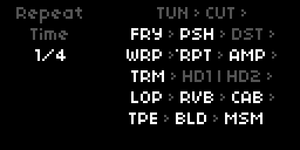

The **GUI** parameter (first in PARAMS, in the GUI group; see [GUI](#gui)) sets how the screen behaves; it changes nothing in the audio path.

- **Studio** (default) is the full interface described in this section: each device is drawn as its own pedal, cabinet or rack unit, and E1 walks the signal chain from end to end. Opens on the Amp. Every view uses the same frame on the right, so the outer edges never move as you walk the chain: a device on its own fills it, two share it side by side or stacked. Devices carry no captions; the strip on the left names the device in focus, and in a pair the focused one shows its lit knob (or, for Hold, Tune and Count, a bright outline). The loop transport icon appears in the strip only on the Loop view.
- **Stage** is a single-screen performance overview. The right side shows the whole chain as centred lines of three-letter abbreviations joined by arrows, with a divider between the two parallel Holds. A device's letters are bright while it is active and dim while bypassed, and a dot above the first letter marks the selected one. The left strip is the readout used everywhere (device, parameter, value). Opens on Tune.
- **Off** blanks the screen and ignores the keys and encoders, for playing in the dark. Switch back from PARAMS or MIDI.

## Controls

Studio and Stage share the same four controls. E1 always walks the signal chain, E2 always picks a parameter of the focused device, E3 always changes it.

| Control | Function |
|---------|----------|
| **E1** | Move through the signal chain, device by device |
| **E2** | Select a parameter of the focused device |
| **E3** | Change its value |
| **K1 hold 2s** | Mod Rack on / off, from either view |
| **K1 + K3 hold 2s** | Add modulation to the focused parameter |
| **K2** | Second function of the focused device: tap tempo (Warp, Repeat, Tremolo, Count), Freeze (Reverb, Build, Mesmerize), Recapture (Hold), stop / start (Tape), Internal / NAM (Amp), reference to 440 Hz (Tune), mute while held (Cut), next mic position (Cab & Mic); Loop: stop → clear, held for two seconds: undo the last overdub. Nothing on Fray, Push, Distort and Route |
| **K3** | Toggle the focused device on or off; on Loop, step the transport; nothing on Route |

**E1** runs through every device in signal order: Route, Tune, Count, Cut, Fray, Push, Distort, Warp, Repeat, Amp, Tremolo, Hold 1, Hold 2, Loop, Reverb, Cab & Mic, Tape, Build, Mesmerize. The views are only the frame around them, which is why the cabinet is entered twice: once for Amp and Tremolo, and again after Hold and Loop for Reverb and Cab & Mic. Route opens the chain on a view of its own. Devices that share a view appear together: Tune beside Count, Cut beside Fray, the pedals in pairs, Hold 1 beside Hold 2, and Build above Mesmerize in a rack; Tape fills a view of its own. When a NAM capture brings its own cabinet, Cab & Mic drops out of the chain (see [NAM](#nam)). Entering a device lands on its first parameter, or on the one you left it on. **E2 reaches every parameter a device owns**, including those the cabinet has no knob for: Tremolo's Sync and Feel, Reverb's Low and High Shelf, and Cab Level. Those show in the left readout while the panel highlight stays on the device's last real knob.

When a source in the Mod Rack (or a Hold's Movement) is moving the focused parameter, the readout shows the live, modulated value with a dim **M** in front of it. Turn the knob and for two seconds it shows the base value you are setting instead, dimmed, with a **B**; then it returns to the live value. A source that is switched off leaves no mark, even while its target stays assigned.

The Stage chain shows the same order minus Route and Count: Route holds settings rather than an effect, and Count produces no sound of its own and sits outside the audio path.

**K3** toggles whatever is focused, so a bypass is always one press away; **K2** works the focused device's second function. **Loop is the exception**: there K3 steps the transport through record → play → dub, and K2 stops then clears; holding K2 for two seconds undoes the last overdub. On Tune, K3 switches the mute and K2 sets the reference back to 440 Hz. On **Warp, Repeat and Tremolo**, K2 taps the tempo (see [Tap tempo](#tap-tempo)); on **Count** it taps the BPM, one tap per beat. On the **Amp**, K2 switches between Internal and NAM (when NAM is available). On **Hold 1** and **Hold 2**, a short K2 recaptures the freeze; on **Tape**, it stops or restarts the tape; on **Reverb**, **Build** and **Mesmerize**, it switches Freeze. On **Cut**, K2 mutes the output for as long as it is held, a kill switch. On **Cab & Mic**, K2 steps the mic position. The drives (Fray, Push, Distort) leave K2 free. **Route** is a place for settings rather than an effect, so K2 and K3 do nothing there; E3 changes the input.

**K1 held for two seconds** opens the Mod Rack over either view and closes it again. The rack shows only what is patched and opens straight into the first source, in the order Sense, LFO, Walk, Trigger. With nothing patched it says **Empty**. To remove a source, hold K1 and K3 on its parameter (for a Trigger, on its device) and choose **Remove**: the source lets go of its target, switches off and returns to its factory settings, so the next one starts fresh.

A source fills the screen: the parameter strip on the left, the source itself on the right in the same frame every device uses, with its target on the line at the bottom of the frame. Each kind of source has one picture, the same in the chooser (with example values) and in the rack (with what the source really does). An LFO draws its live output, the last two cycles (sixteen steps in Stepped Random) of the value it actually sends, across the target's range, with the base as a dotted line, so Depth, Direction, Rate Slew, rate modulation and clipping at the range ends all show as they happen. A Sense draws the envelope it hears over the last three seconds, around a centre line, the way an envelope traces the peaks of an audio signal. A Walk shows all sixteen steps as bars above and below a centre line with a running light underneath; steps beyond its step count stay as dashed outlines of their stored values. A Trigger shows its last eight chances: a filled bar for each fire, an empty frame where Probability let one pass. **E1** steps to the previous or next patched source, **E2** scrolls the strip, **E3** changes the value. A short **K3** switches the source on and off. A short **K2** works its second function: an LFO restarts its cycle from phase 0, a Sense freezes its modulation (or releases it), a Walk jumps back to step 1, a Trigger fires once by hand. **K2** held randomises a Stepped Random register or a Walk's steps. **K1** held leaves the rack again. Tune and Count are not in the rack; they sit at the head of the signal chain instead.

**K1 and K3 held together for two seconds** start from the other end: from the parameter in focus. A chooser takes over the device area and asks how to move it. **E2** or **E3** picks **Modulate** (an LFO), **Sense**, **Walk** or **Trigger**, each shown with its picture running on example values. **K3** takes it: the next free slot of that kind is patched to the parameter (a Trigger to the device itself, starting with its first free action such as Toggle), switched on, and opened in the rack for setting up. If every slot of that kind is taken, the picture dims and reads *full*. If a source already drives the parameter, the chooser offers **Edit** (open it in the rack) and **Remove** instead, and the same for every Trigger already on the device. **K2** closes the chooser without changes.

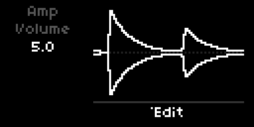


## Tune

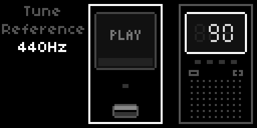

Tune sits at the head of the signal chain: walk E1 to the far left of the chain and it occupies the left half of the pane, beside Count. The note name and octave appear at large size, with a strobe band underneath: it drifts one way while you are flat and the other way while you are sharp, and stands still once you are in tune, when the small lamp below the window lights up as well. With no note to hear, the window reads PLAY. Press K3 to mute the output while tuning. The mute is a real parameter now, so it stays engaged until you press K3 again, and the Tune block stays lit as the reminder. The looper keeps playing under the mute, so a tuning pause doesn't break the loop.

Turn E3 while the tuner is open to adjust the reference pitch (420 to 460 Hz). The setting is saved with your PSET.

princeton's tuner runs its own pitch detector inside the engine on a boosted, band-limited copy of the input. Passive electric guitars sit too low for the Norns built-in pitch poll to track reliably; the in-engine version stays locked through string decay.

## Parameters

Parameters are listed in PARAMS menu order.

### GUI

How princeton meets your hands and your MIDI controller. Nothing here touches the sound; it decides where the screen looks and how a knob takes hold of a value.

| Parameter | Default | Range / Options |
|-----------|---------|-----------------|
| **GUI** | Studio | Studio / Stage / Off |
| **Follow Focus** | On | Off / On |
| **MIDI Pickup** | On | Off / On |
| **Initialize** | trigger | PARAMS and MAP |

**GUI** picks the screen mode (see [GUI modes](#gui-modes)).

**Follow Focus** lets the screen follow your controller. When a mapped MIDI control moves a parameter, the view jumps to its device and selects that parameter; when a single device is switched on or off, or the looper changes state, from outside the screen (MIDI, PARAMS), the view moves to that device. Actions fired by the Mod Rack's Triggers never move the view.

**MIDI Pickup** is soft takeover for mapped CCs: a knob whose position does not match the parameter's current value has no effect until it reaches or passes that value, then takes over without a jump. Relative (accumulating) mappings are not affected. Off applies every CC immediately.

**Initialize** sets every parameter back to its default in one go. MIDI mappings stay as they are.

### Signal Flow

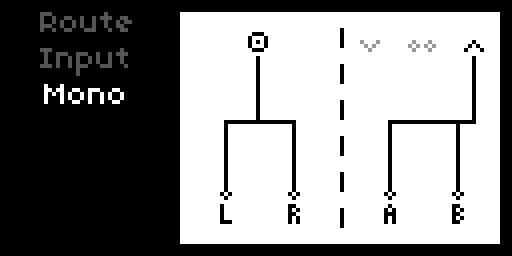

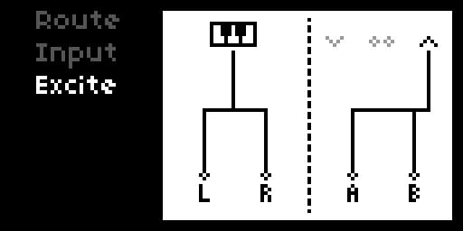

| Parameter | Default | Range / Options |
|-----------|---------|-----------------|
| **Input** | Mono | Mono / Stereo / one entry per installed voice, by name |
| **Input Trim** | 0 dB | -75 to +10 dB |
| **Send A Source** | Output | Input / Loop / Output |
| **Send A Level** | 0 dB | -60 to +10 dB |
| **Send B Source** | Output | Input / Loop / Output |
| **Send B Level** | 0 dB | -60 to +10 dB |

**Mono** uses the left input only at instrument level. This is the default, designed for a guitar plugged into the L jack. **Stereo** opens both inputs at line level (about 10 dB lower) and routes a symmetric stereo path through Push, Distort, Warp, Repeat, and the amp. The tremolo's left/right pingpong, the looper's stereo buffer, and the reverb stay unchanged in either mode. Choosing a **voice** (one entry per installed voice mod, listed by name in alphabetical order) mutes the hardware inputs and feeds the chain in stereo from that voice instead, played over MIDI through [Keys](#keys) (see [Voices](#voices)); the Sense envelope followers then track the voice. Only one voice sounds at a time, and switching away silences it. With no voice mod installed the list ends at Stereo.

**Input Trim** scales the signal as it enters the chain, before every pedal and the amp. It sits at instrument level by default (0 dB) and runs from -75 dB (near silence) to +10 dB. Being a plain control, it maps to a MIDI CC in the usual PARAMS way, so a MIDI expression pedal on Input Trim becomes a volume pedal in front of the whole chain. The tuner reads the raw input ahead of the trim, so tuning still works with the trim pulled all the way down; the Sense envelope followers and the metronome click are unaffected for the same reason. Input Trim acts on the hardware inputs only; a voice sets its own level in its PARAMS group.

The two pixels on the amp panel reflect the active inputs. The left pixel always lights; the right pixel lights only in Stereo.

**Send A** and **Send B** route to the two Norns send buses, which a compatible fx mod can read in its send a or send b slot. Each send picks its source independently: **Input** is the post-pedal signal feeding the amp, **Loop** is the looper output on its own, and **Output** is the full mix at OUT L/R. **Level** scales the send from -60 dB (effectively off) up to +10 dB. With both sends at their defaults (Output, 0 dB) each carries the full output at unity, the same as before the sources became selectable.

**fx mod.** The sends reach an fx mod through its send buses `~sendA` and `~sendB`. The mod is optional, and princeton adapts to whichever version is installed, no patch needed. Without the mod both sends simply rest while everything else works as usual. If a send bus of the mod lands on the Norns input or output (older versions of the mod put `~sendA` on the input bus), princeton gives that send a free bus of its own and points the mod's plugins there while princeton runs; on exit it hands the mod its original bus back. What princeton found is written to the SuperCollider log in maiden at every start, one line per send.

**Route** (RTE) is the first device of the Studio chain and holds all six parameters; they are also in PARAMS and MAP. Route is drawn as a white panel, which sets it apart from the effects as a place for settings, and it shows the routing rather than knobs; the values appear in the readout on the left. Both halves read from top to bottom, the way the signal flows, with straight lines and right angles only. The left half shows the input at the top: a jack that splits halfway down to L and R for Mono, two jacks running straight down for Stereo, a small module for any voice. The right half shows the sends: three taps at the top, ∨ (Input), ∞ (Loop) and ∧ (Output), with a line from the chosen tap down to A and to B, bending halfway. A tap that neither send uses is greyed out; when both sends take the same tap, its line splits. Where the two send lines would cross, the horizontal one leaves a small gap so you can follow each. **K3** steps the input through Mono, Stereo and each installed voice, then back to Mono. Route is not part of the Stage chain.

The chosen voice is also stored by name in the PSET, so a PSET still finds its voice after another voice mod has been added or removed and the list has shifted. If the voice mod is missing, the input falls back to Mono, and the name is kept for the next save.

### Keys

The hands between the keyboard and the voice. Keys can hold a chord after you let go, restrike it on the clock like a mandolin tremolo, and lift every strike an octave higher, a staircase that folds back on itself. Keys only acts while Route's input is a voice; in Mono and Stereo incoming notes are ignored.

| Parameter | Default | Range / Options |
|-----------|---------|-----------------|
| **Hold** | Off | Off / On |
| **Retrig** | Off | Off / On |
| **Retrig Division** | 1/16 | 1/4 / 1/8 / 1/16 / 1/32 |
| **Retrig Feel** | Note | Note / Dotted / Triplet |
| **Retrig Swing** | 50 % | 50–75 % |
| **Retrig Gate** | 50 % | 10–100 % |
| **Octaves** | 1 | 1 / 2 / 3 / 4 |
| **Octave Reset** | Off | Off / 1–64 strikes |
| **MIDI Device** | All | All / each connected MIDI port |
| **MIDI Channel** | Omni | Omni / 1–16 |

**Hold** keeps the chord sounding after the keys are released. Keys struck within 100 ms of each other join the held chord; the next chord struck after all keys are up replaces it.

**Retrig** strikes the held keys (or the Hold chord) again together on every step of a grid locked to the Norns clock. **Retrig Division** and **Retrig Feel** set the step, **Retrig Swing** delays every second step (50 % is straight), **Retrig Gate** sets how long each strike sounds as a share of the step. The four Retrig settings appear only while Retrig is On.

**Octaves** moves every new strike, or every Retrig hit, one octave further up and starts over after that many octaves; at 1 nothing moves. Keys struck together share one octave. **Octave Reset** returns to the original octave after that many strikes; it appears only while Octaves is above 1.

**MIDI Device** listens to all ports by default, which suits controllers that show up as more than one port; pick a single port to keep other devices out. **MIDI Channel** is Omni by default. Notes with velocity, polyphonic and channel aftertouch, pitch bend (±2 semitones) and the sustain pedal (CC 64) are passed on to the voice. All notes are released when the device or channel changes, when the voice changes, and when the script stops.

**CCs.** On the same device and channel, five CCs set Keys directly: **69** Hold and **70** Retrig (value ≥ 64 is On), **71** Retrig Division and **72** Octaves (0–31, 32–63, 64–95, 96–127 select the four options), **73** Octave Reset (the value is the number of strikes, 0 is Off).

### Voices

A voice is a small instrument that lives outside princeton and plays through it. Voices come as norns mods, so princeton stays a guitar rig until you invite one in; once chosen in Route, it stands where the guitar stood and every pedal, the amp, the loop and the reverbs take it in.

**Bringing one in.** Copy the voice mod's folder to `~/dust/code/`, enable it in **SYSTEM > MODS** and restart norns, because its SuperCollider part only loads when SuperCollider starts (the same restart is needed after an update). From then on the voice appears by name in Route's **Input** list, after Mono and Stereo; choose it there or step to it with **K3** on Route. Play it from any MIDI keyboard set up under [Keys](#keys); the voice's own parameters appear as a PARAMS group of their own, mappable to MIDI like everything else.

A voice chosen in Route but missing in SuperCollider stays silent, and princeton reports it in the log (maiden) with a hint to restart.

### Tune

| Parameter | Default | Range |
|-----------|---------|-------|
| **Engage** | Bypass | Bypass / Active |
| **Reference** | 440.0 Hz | 420–460 Hz |

**Engage** is the tuner mute: Active silences the output so you can tune quietly, Bypass lets the guitar through. It behaves like the footswitch on a tuner pedal, so it stays where you put it when you move to another device, and the Tune block lights up while it is engaged. Being a plain parameter it maps to a MIDI CC in the usual PARAMS way, which turns a footswitch into a mute. K3 toggles the same switch while Tune is in focus.

**Reference** is adjustable with E3 while the tuner is open. Saved with your PSET.

### Count

| Parameter | Default | Range / Options |
|-----------|---------|-----------------|
| **Engage** | Off | Off / On |
| **BPM** | 120 | 20–300 |
| **Division** | 1/4 | 1/1 / 1/2 / 1/4 / 1/8 / 1/16 |
| **Level** | 5.0 | 0–10 |
| **Root** | C | C / C# / D / D# / E / F / F# / G / G# / A / A# / B |
| **Register** | 3 | 0 / 1 / 2 / 3 / 4 / 5 / 6 / 7 |
| **Length** | 50 ms | 1–500 ms |
| **Scale** | Off | Off / Chromatic / Major / Minor / Dorian / Pent Maj / Pent Min / Blues |
| **Chords** | Off | Off / Octaves / Power Chords / Triads |
| **Scale Play** | Off | Off / Forward / Reverse / Interval (Thirds / Fourths / Fifths / Sevenths) / Random |
| **Position** | Parallel | Parallel / Inline |

The click fires as a short sine-wave burst; pitch shifts relative to A4 (440 Hz) in semitones. **Root** picks the chromatic note name and **Register** the octave (0 to 7), together covering C0 to B7; the defaults give C3. **Level** and **Length** set the click's loudness and decay, short values giving a tight transient and longer ones a tone burst. All entries live in the PARAMS menu and are MIDI-mappable.

**Position** controls where the click enters the signal chain. **Parallel** sends it straight to the output, bypassing all engine processing. **Inline** routes it through the full chain (Pedals, Amp, Tremolo, Looper, Reverb, Cab), so the click takes on whatever is dialled in; a click that fires during a looper recording lands in the buffer.

The next three parameters turn the metro from a click into a small voice. They build on each other and all run off the same clock.

**Scale** picks the scale the voice uses. At **Off** (the default) only the Root note plays, exactly like a plain metronome. Any other scale (Chromatic, Major, Minor, Dorian, Pentatonic Major or Minor, Blues) is rooted at the current Root and becomes the pool for Chords and Scale Play. Scale also snaps Mod Rack root-note modulation: an LFO targeting Count: Root lands on scale tones rather than chromatic steps. Direct edits to Root and Register are never quantised.

**Chords** stacks harmony on every note the metro plays. **Octaves** adds the note one octave up; **Power Chords** add the fifth; **Triads** add the third and the fifth. With a Scale selected the third and fifth are diatonic, so the chord follows the scale (a Minor scale gives minor triads, the leading tone gives a diminished triad); with Scale = Off they fall back to a fixed major third and perfect fifth. Each chord tone is its own click, so chords work in both Parallel and Inline positions.

**Scale Play** sequences the metro through the scale, one step per click, so it plays a line instead of repeating one note. **Forward** climbs from the Root and wraps after the octave; **Reverse** descends from the octave back to the Root. The **Interval** modes climb in thirds, fourths, fifths, or sevenths and wrap after the second octave. **Random** picks a random scale tone within the Register on each click. Scale Play needs a scale, so it is hidden while Scale = Off. When Chords is also on, every sequenced note gets its chord, for a harmonised line.

Because Root, Register, Level, Length, Scale, Chords, and Scale Play are all Mod Rack targets, Count becomes a playable voice: an LFO on Count: Root transposes the whole line, one on Count: Register shifts its octave, and slow LFOs on Scale, Chords, or Scale Play evolve the pattern over time. Stack it on the loop and the rest of the rack and Count is a built-in practice partner.

When the Norns clock is running, **Division** sets the click subdivision relative to the clock; the metro stays in lockstep with any synced effect. With the clock stopped it free-runs at **BPM**. BPM sits first in the Count strip (E3). With the internal clock, turning it sets the Norns tempo, so every synced effect follows; with MIDI clock it follows the incoming tempo and only takes over while the clock is stopped. Old PSETs that stored BPM as text still load.

### Cut

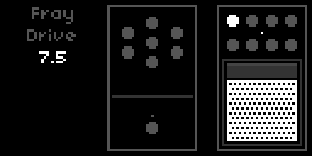

| Parameter | Default | Range / Options |
|-----------|---------|-----------------|
| **Cut Engage** | Bypass | Bypass / Active |
| **Threshold** | −50 dB | −80–0 dB |
| **Attack** | 1 ms | 0.1–2500 ms |
| **Hold** | 20 ms | 1–2500 ms |
| **Release** | 100 ms | 1–2500 ms |
| **Range** | −75 dB | −75–0 dB |
| **Margin** | 0 dB | 0–25 dB |
| **Detection** | Peak | Peak / RMS |

A gate at the front of the signal chain, before Push, bypassed by default. The detector reads `(L + R) × 0.5`. Threshold sets the level the signal must exceed to open the gate; Range sets how far the signal is attenuated when the gate is closed (−75 dB is near silence, a smaller value like −12 dB ducks rather than mutes). Attack and Release are the open and close ramp times, both reaching up to 2.5 s: a long Attack gives slow-gear volume swells, a fast Attack with short Hold and Release gives percussive chopping. Hold keeps the gate open for a set time after the signal drops, preventing chatter and sustaining tails. Margin sets the gate's hysteresis: it widens the gap between the open and close thresholds, from none up to 25 dB. Detection picks a fast Peak follower or a smoother RMS follower. All six continuous parameters are Mod Rack and Sense targets, so an LFO on Threshold synced to the clock produces rhythmic gating. Attack, Hold and Release use an exponential taper, so small values step finely and large values step coarsely. A **Cut: Toggle** trigger switches the gate in and out. Cut shares a Studio pane with Fray, and appears in the Stage chain as CUT.

### Fray

| Parameter | Default | Range / Options |
|-----------|---------|-----------------|
| **Fray Engage** | Bypass | Bypass / Active |
| **Drive** | 7.5 | 0–10 |
| **Comp** | 5 | 0–10 |
| **Stab** | 0 | 0–10 |
| **Octave** | 0 | 0–10 |
| **Oct Mode** | Up | Down / Up / Both |
| **Gate** | 0 | 0–10 |
| **Tone** | 10 | 0–10 |
| **Volume** | 5.0 | 0–10 |

A deliberately unstable fuzz in the Fuzz Factory tradition, sitting between Cut and Push and bypassed by default. Where Push is a compressed overdrive and Distort a hard clipper, Fray is the third kind: a starved circuit that spits, chokes and, pushed far enough, sings on its own.

**Drive** is the fuzz gain, from a rough edge up to a fully saturated square. **Comp** starves the operating point, and does it dynamically: the bias drifts further off centre as the note dies away, so the tail chokes and spits instead of decaying evenly. That is the velcro splutter, and it lives in the decay rather than the attack.

**Stab** collapses the supply under load and feeds the stage back into itself. Low settings add a sag and a bloom on hard notes; towards the top the feedback path narrows into a resonance and the circuit sings on its own after you stop playing. The whole range is usable, because the feedback is injected after the input stage has been brought to a fixed level, so its loop gain does not ride on Drive.

**Octave** sets how much of an added octave is blended in, and **Oct Mode** picks which one. **Up** rectifies the signal to double its frequency, the classic octave fuzz; it speaks clearest at moderate Drive, because a fully squared signal has little left to rectify, so back Drive off if the octave gets lost. **Down** clocks a flip-flop divider off the zero crossings for a sub-octave, as in an analogue octave pedal, and follows your dynamics rather than sitting at a fixed level. **Both** mixes the two for a wide, slightly unhinged stack. At Octave 0 the switch does nothing.

**Gate** chokes the decay rather than letting it fizzle out, and reads the input rather than the fuzz, so it cuts note tails instead of strangling the distortion. **Tone** is a low-pass after the fuzz, fully open by default and reaching down to 750 Hz; its top sits at 7.5 kHz because the input stage already band-limits the whole chain there, so there is nothing above that to keep. **Volume** sets the output level. At 5.0 Fray sits about 1 dB above the clean amp with its default settings, so switching it on adds a slight lift rather than a jump; pull Volume down as Drive goes up.

Gate and Stab are the two worth handing to the [Mod Rack](#mod-rack): an LFO on Gate gives rhythmic stutter, and one on Stab makes the circuit wander in and out of oscillation. All seven continuous parameters are Mod Rack and Sense targets, Oct Mode being a plain switch, and a **Fray: Toggle** trigger can switch the whole pedal in and out.

Being bypassed by default it costs nothing until engaged: like Push and Distort it runs as a spawned insert, so a bypassed Fray is not merely silent but absent from the graph.

### Push

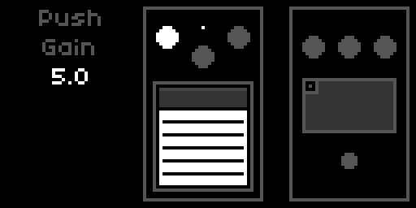

| Parameter | Default | Range / Options |
|-----------|---------|-----------------|
| **Push Engage** | Bypass | Bypass / Active |
| **Gain** | 5.0 | 0–10 |
| **Tone** | 5.0 | 0–10 |
| **Level** | 5.0 | 0–10 |
| **Comp** | 5.0 | 0–10 |

A compressor and an overdrive in one: the signal is squeezed, then driven into a soft saturation. Tone tilts the voice around 700 Hz, from warm and full to tight and cutting. Comp sets how hard Push squeezes the signal before it saturates: low values let the pick attack through, high values even out the dynamics into a steady sustain. The gain reduction follows the envelope of your playing, not every single wave. At the default Level of 5.0 Push sits about 0.5 to 1 dB above the clean amp, a slight lift rather than a jump.

### Distort

| Parameter | Default | Range / Options |
|-----------|---------|-----------------|
| **Distort Engage** | Bypass | Bypass / Active |
| **Gain** | 5.0 | 0–10 |
| **Tone** | 7.5 | 0–10 |
| **Level** | 5.0 | 0–10 |
| **Low Cut** | Off | Off / 100 Hz / 250 Hz |

Hard clipping distortion. Tone sweeps a low-pass filter from 300 Hz (muffled, murky) to 5000 Hz (open, cutting). Low Cut applies a post-drive high-pass filter to remove accumulated sub-bass. At the default Level of 5.0 Distort sits about 0.5 to 1 dB above the clean amp.

### Warp

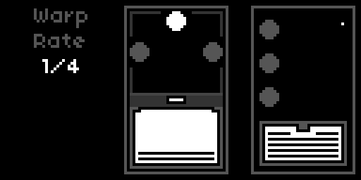

| Parameter | Default | Range / Options |
|-----------|---------|-----------------|
| **Warp Engage** | Bypass | Bypass / Active |
| **Rate** | 2.5 Hz | 0.1–25 Hz (exp) |
| **Depth** | 5 % | 0–100 % |
| **Rise/Fall** | 2.5 s | 0.01–5.0 s (exp) |
| **Mix** | 0 % | 0–100 % |
| **Sync** | Off | Off / 8/1 / 4/1 / 2/1 / 1/1 / 1/2 / 1/4 / 1/8 / 1/16 / 1/32 / 1/64 |
| **Sync Feel** | Note | Note / Dotted / Triplet |
| **Tap Div** | 1/4 | 8/1 / 4/1 / 2/1 / 1/1 / 1/2 / 1/4 / 1/8 / 1/16 / 1/32 / 1/64 |
| **Tap Feel** | Note | Note / Dotted / Triplet |
| **Tap** | trigger | PARAMS and MAP |

Pitch vibrato via modulated delay. At 0 % Mix the effect is 100 % wet; increasing Mix blends in the dry signal, moving from pure vibrato toward a chorus character. Rise/Fall controls the onset time when bypass is lifted and the fade time when bypass is engaged.

Set **Sync** to a division to lock Rate to the Norns clock. See [Synchronization](#synchronization) for the full model.

### Repeat

| Parameter | Default | Range / Options |
|-----------|---------|-----------------|
| **Repeat Engage** | Bypass | Bypass / Active |
| **Time** | 250 ms | 1–1000 ms |
| **Feedback** | 50 % | 0–100 % |
| **Level** | 50 % | 0–100 % |
| **Color** | Bright | Bright / Dark |
| **Mod Depth** | 10 % | 0–100 % |
| **Mod Rate** | 2.5 Hz | 0.1–10 Hz |
| **Sync** | Off | Off / 8/1 / 4/1 / 2/1 / 1/1 / 1/2 / 1/4 / 1/8 / 1/16 / 1/32 / 1/64 |
| **Sync Feel** | Note | Note / Dotted / Triplet |
| **Tap Div** | 1/4 | 8/1 / 4/1 / 2/1 / 1/1 / 1/2 / 1/4 / 1/8 / 1/16 / 1/32 / 1/64 |
| **Tap Feel** | Note | Note / Dotted / Triplet |
| **Tap** | trigger | PARAMS and MAP |

BBD-style analog delay with jitter and saturation in the feedback path. Color switches between a brighter and a darker feedback tone.

Set **Sync** to a division to lock Time to the Norns clock. See [Synchronization](#synchronization) for the full model.

### Tap tempo

With Warp, Repeat or Tremolo focused, **K2** taps the tempo (on Count it taps the BPM directly, one tap per beat). The second tap sets the value, and every further tap refines it, averaged over the last four intervals. A pause longer than two seconds, or more than twice the running interval, starts a new series. The readout jumps to Rate or Time and blinks on every tap.

A tap marks one beat. **Tap Div** and **Tap Feel** (PARAMS, under Synchronization) say what that beat means for the effect: at 1/4 Note the delay time equals the tap interval, at 1/8 Repeat runs twice as fast as you tap, at 1/4 Dotted one and a half times as slow. Changing Tap Div or Tap Feel recalculates from the last tapped tempo, there is no need to tap again. The calculation is the same one Sync uses, so a tapped 1/8 and a synced 1/8 at the same tempo land on the same value.

Repeat Time ends at 1000 ms, so slow tempos clamp. A clamped tap stays dimmed in the readout until you change the value by hand. Where the clamp starts depends on Tap Div:

| Tap Div | Repeat clamps below |
|---|---|
| 1/2 | 120 BPM |
| 1/4 | 60 BPM |
| 1/8 | 30 BPM |
| 1/16 | 15 BPM |

Warp covers 0.1 to 25 Hz, which takes any tempo a hand can tap.

Tap tempo only works while Sync is Off. With Sync set and the clock running, K2 does nothing on Warp, Repeat and Tremolo, and switching Sync on or off forgets the tapped tempo. If a tap lands while an LFO modulates Rate or Time, it moves the centre of the modulation, as a manual change would.

To tap from a footswitch, map the **Tap** entry of Warp or Repeat to a CC (see [MIDI](#midi)). If your other gear sends MIDI clock, that is the better route: set SYSTEM > CLOCK > source to MIDI and use Sync instead, which follows the external tempo exactly.

### Amp

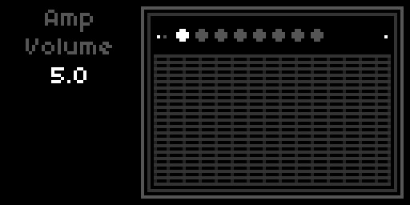

| Parameter | Default | Range / Options |
|-----------|---------|-----------------|
| **Engage** | Active | Active / Bypass |
| **Amp** | Internal | Internal / NAM (see [NAM](#nam)) |
| **Model** | first capture | one entry per `.nam` file (NAM only) |
| **Cab Sim** | Auto | Auto / On / Off (NAM only) |
| **Volume** | 5.0 | 0–10 |
| **Bass** | 2.5 | 0–10 |
| **Mid** | 5.0 | 0–10 (NAM only) |
| **Mid Freq** | 750 Hz | 250–4000 Hz (NAM only) |
| **Treble** | 5.0 | 0–10 |
| **Master** | 7.5 | 0–10 |
| **Rectifier** | Tube 5U4 | Tube 5Y3 / Tube 5U4 / Silicon (Internal only) |

A dedicated **Engage** toggle (AMP group) lives in the PARAMS menu for MIDI mapping. Same behaviour as Reverb and Tremolo bypass.

**Rectifier** picks the rectifier in the amp's power supply, which sets how far the supply voltage sags when you dig in and how quickly it recovers. **Tube 5Y3** is the stock Princeton: the deepest and slowest sag, the least headroom, an earlier break-up and a looser low end. **Tube 5U4** is the Princeton Reverb's rectifier and the amp as it always sounded. **Silicon** barely sags and recovers fast, for more headroom, a tighter attack and a firm low end, the direction of the early Princeton-based Boogie conversions with their bigger power stage. The three settings are level-matched at medium drive, so switching changes the feel, not the volume. Rectifier is set in the PARAMS menu only and is a Mod Rack target (Amp: Rectifier).

#### NAM

The combo can lend its chair to another amp. A Neural Amp Modeler capture is a snapshot of a real amp, pedal or full rig, learned from recordings of it; princeton plays it in place of its own preamp and power stage, and keeps its tone controls wrapped around it.

| Step | |
|---|---|
| **Captures** | Put `.nam` files in `dust/data/princeton/nam/` (created on the first start). |
| **Install** | On every start princeton checks that its NamAmp plugin (`lib/nam/NamAmp.so`) is installed in `~/.local/share/SuperCollider/Extensions/princeton/` and copies it there if it is missing or has changed. After a copy, restart norns (SYSTEM > RESTART) so SuperCollider loads it. |
| **Check** | At every start the SuperCollider log in maiden reads `princeton: NAM available` or `not available`. |

**Amp** switches between **Internal**, the built-in combo, and **NAM**. NAM is offered only when the plugin is loaded and at least one `.nam` file is present; otherwise the list shows Internal alone. With NAM selected, the entry below it is the **Model** list: the capture file names, with a prefix common to all of them left off. Model is also the first parameter on the Amp itself, so E2 to the left end and E3 flips through the captures; a capture loads once the knob has rested for a quarter of a second. Capture names are usually longer than the strip can show, so the strip shows the capture's place in the list (3/9); the full names are in PARAMS. **Rectifier** hides, and **Mid** and **Mid Freq** appear.

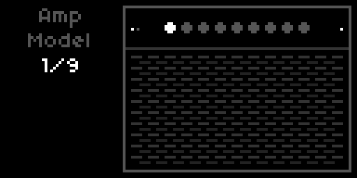

**Volume** drives the capture's input, from −12 dB to +12 dB across its range. **Bass** and **Treble** are shelves at 250 Hz and 2.5 kHz, **Mid** a bell at **Mid Freq**; at Bass 2.5, Mid 5 and Treble 5 they are flat. In NAM mode the cabinet knob row reads Volume, Bass, Mid, Treble, Master. Amp: Mid and Amp: Mid Freq are Mod Rack targets.

**Cab Sim** decides whether Cab & Mic stays in the chain. **Auto** reads the capture's metadata and removes Cab & Mic when the capture is a full rig or already includes a cabinet, and keeps it for an amp-only capture. **On** always keeps it, **Off** always removes it. A removed Cab & Mic disappears from the Studio and Stage chains and its parameters hide.

### Tremolo

| Parameter | Default | Range / Options |
|-----------|---------|-----------------|
| **Engage** | Active | Active / Bypass |
| **Speed** | 2.5 Hz | 0.1–25 Hz (exp) |
| **Intensity** | 0 % | 0–100 % |
| **Sync** | Off | Off / 8/1 / 4/1 / 2/1 / 1/1 / 1/2 / 1/4 / 1/8 / 1/16 / 1/32 / 1/64 |
| **Sync Feel** | Note | Note / Dotted / Triplet |
| **Tap Div** | 1/4 | 8/1 / 4/1 / 2/1 / 1/1 / 1/2 / 1/4 / 1/8 / 1/16 / 1/32 / 1/64 |
| **Tap Feel** | Note | Note / Dotted / Triplet |
| **Tap** | trigger | PARAMS and MAP |

On the device, turn Intensity to 0 to silence the tremolo. A dedicated **Engage** toggle (TREMOLO group) lives in the PARAMS menu for MIDI mapping, same rationale as the reverb's.

Set **Sync** to a division to lock Speed to the Norns clock. The encoder strip then displays the division name (e.g. `1/8`, `1/4.`) instead of Hz. See [Synchronization](#synchronization) for the full model.

### Hold

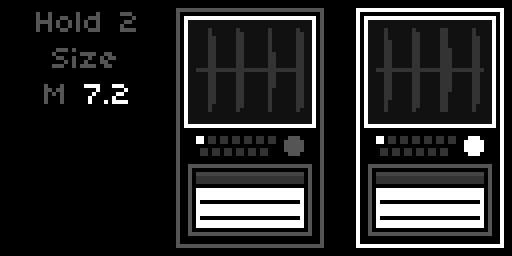

Two independent granular freezes, **Hold 1** and **Hold 2**, running in parallel between Tremolo and Loop so they capture the fully amped, post-tremolo signal. The held pads go into the looper's input along with the live signal, so a loop recorded or overdubbed while a pad is held keeps it, while a loop that is only playing leaves it untouched. The Hold recorder itself listens to the live signal alone, so a new freeze never captures the pad that is still sounding. Engaging a Hold grabs the last ~1.2 seconds you played and sustains it as a granular pad; the live signal always passes through underneath, so you can play over the held sound. Because the pad is built from grains reading a frozen snapshot, it never loops audibly and can be transposed without running out. A single rolling recorder feeds both instances, so the second one costs only its own grain playback.

Both instances share the same parameter set, in the PARAMS groups **HOLD 1** and **HOLD 2**. They are set up to differ out of the box: Hold 2 starts with Size, Density and Spread at 7.5, and the two are pitched opposite ways, Hold 1 an octave down and Hold 2 an octave up, each mixed in lightly at 10 %.

| Parameter | Default | Range / Options |
|-----------|---------|-----------------|
| **Engage** | Bypass | Bypass / Active |
| **Size** | 5 | 0–10 |
| **Density** | 5 | 1–10 |
| **Spread** | 5 | 0–10 |
| **Movement** | 2.5 | 0–10 |
| **Pitch** | −12 st (Hold 1) / +12 st (Hold 2) | −24–+24 st |
| **Pitch Mix** | 10 % | 0–100 % |
| **Reverse Mix** | 0 % | 0–100 % |
| **Shape** | Smooth | Smooth / Soft / Swell / Pluck / Plateau |
| **Resolution** | Fine | Coarse / Fine |
| **Gain** | 5 | 0–10 |
| **Level** | 5 | 0–10 |
| **Rise** | 0.25 s | 0.01–5.0 s (exp) |
| **Fall** | 2.5 s | 0.01–5.0 s (exp) |

**Engage** is the freeze itself: switch to Active to grab and hold, back to Bypass to release. The pad fades in over **Rise** and out over **Fall**, so a long Fall lets the held chord bloom away after you release. Re-engaging while a previous Fall is still running spills the old pad over the new one for a smooth crossfade. **Recapture** does the same in one step while the Hold stays engaged: it grabs what you just played as a new freeze, fades it in over Rise and lets the old pad fade out over Fall, with no gap in between. It is a trigger in PARAMS for MIDI and a Mod Rack trigger target, so a trigger on 1/1 refreshes the pad on every bar; while the Hold is bypassed it does nothing.

**Gain** drives the pad into a soft saturation for thickness and character; **Level** is its output level in the mix, and the two are independent. **Size** sets the grain length, longer toward 10 for a smoother, more sustained pad. **Density** sets how thickly the grains overlap. **Spread** scatters the grain onsets in time, from a tight, regular texture at 0 to a diffuse cloud at 10.

**Movement** lets Size, Density and Spread drift on their own: each follows its own slow random curve (one gentle move every six to eight seconds), positive and negative around the value you set. At 10 they swing up to ±2.5, at the default of 2.5 by ±0.6, and at 0 the pad stands still. Near the end of a range the drift turns back instead of sticking to the limit. The value you set stays the base for PARAMS, presets and the Mod Rack; Movement only rides on top of it. While Movement is active, the readout shows the moving value with an **M** (see [Controls](#controls)), and the grain view follows it.

**Pitch** transposes the pad in semitones (−12 is one octave down, +12 one octave up). **Pitch Mix** sets how many grains get that transposition: at 100 % the whole pad is shifted, at lower values only a fraction is, so the default of 10 % sprinkles a few octave grains over an otherwise untransposed pad.

**Reverse Mix** sets how many grains play backwards, decided per grain like Pitch Mix. At 0 % everything runs forwards; small amounts add a soft, swelling shimmer against the forward grains, and at 100 % the whole pad runs in reverse. It combines with Pitch, so a grain can be both transposed and reversed.

**Shape** sets the grain window and with it the character of every grain: Smooth is the neutral bell, Soft is gentler still, Swell rises slowly then cuts off (a reverse-tape feel), Pluck attacks fast and tails off (articulated, almost rhythmic), and Plateau is nearly flat for the densest, most present pad. Plateau does not fall to silence at the grain edges, so it can add a faint edge to the texture. **Resolution** trades CPU against pitch quality: Fine is cleanest, Coarse is cheaper and only sounds grainier when Pitch is in use, so an untransposed instance can run Coarse to save headroom.

Each Hold is a full [Mod Rack](#mod-rack) target (Size, Density, Spread, Pitch, Pitch Mix, Reverse Mix, Gain, Level, Movement per instance). **Hold 1: Toggle** and **Hold 2: Toggle** triggers switch either freeze on and off rhythmically, **Hold 1: Recapture** and **Hold 2: Recapture** refresh a running freeze. In the Stage chain both appear, joined by a divider to show they run in parallel.

### Loop

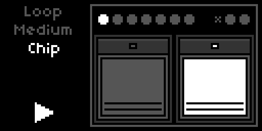

| Parameter | Default | Range / Options |
|-----------|---------|-----------------|
| **Step Order** | Rec·Play·Dub | Rec·Play·Dub / Rec·Dub·Play |
| **Play From** | Start | Start / Cue |
| **Mode** | Overdub | Overdub / Overwrite / Sample / Resample |
| **Direction** | Forward | Forward / Reverse / Pendulum / Random |
| **Rec Level** | −2.5 dB | −40–0 dB |
| **Play Level** | −2.5 dB | −40–0 dB |
| **Fade Level** | −2.5 dB | −40–0 dB |
| **Speed** | 0 % | −100–+100 % |
| **Speed Control** | Steps | Steps / Smooth |

**Step Order** picks which K2 sequence the looper follows: `Rec → Play → Dub → Play …` (default) or `Rec → Dub → Play …`. K3 is unaffected.

**Play From** controls what happens when playback resumes after a stop. **Start** always returns to the beginning of the loop. **Cue** resumes from the position where the loop was stopped.

**Mode** selects how dub passes interact with the buffer. **Overdub** layers new material over existing. **Overwrite** replaces it. **Sample** stops after one playback pass; K2 retriggers from the **Play From** position. **Resample** records the loop output back into the buffer including the medium's degradation chain.

**Direction** sets the loop playback direction. **Forward** is conventional. **Reverse** plays the buffer backwards. **Pendulum** alternates forward and reverse at each loop boundary. **Random** flips direction unpredictably at each boundary for generative texture.

**Rec Level** and **Play Level** control recording gain (initial pass and overdub) and playback gain independently. **Fade Level** sets the gain curve at the loop boundary fade.

**Speed** is bipolar. In **Steps** mode it snaps to −100 % (half speed, octave down), 0 % (normal), or +100 % (double speed, octave up). In **Smooth** mode it moves continuously across the full range, exponentially mapped (`2 ^ (Speed/100)`). Speed affects both record and replay.

#### Medium

| Parameter | Default | Range / Options |
|-----------|---------|-----------------|
| **Medium** | Chip | BBD / Cassette / CD / Chip / Tape / Vinyl |
| **Imprint** | 10 % | 0–100 % |
| **Wear** | 5 % | 0–100 % |
| **M: BBD Tone** | Bright | Bright / Dark |
| **M: Cassette Wow** | 5 % | 0–100 % |
| **M: CD Errors** | 0 % | 0–100 % |
| **M: Chip Crush** | 0 % | 0–100 % |
| **M: Tape Wow** | 5 % | 0–100 % |
| **M: Vinyl Noise** | 10 % | 0–100 % |

**Medium** picks the storage type the loop pretends to be, and it works in two layers. **Imprint** and **Wear** are destructive: they bake the medium's base character (its filtering and saturation) into the buffer. **Imprint** controls how strongly that base character colours the signal at the moment of recording: at 0 % the buffer captures your input clean, at 100 % the first repeat already has the medium's full character. **Wear** controls how much it degrades the loop on each subsequent pass: at 0 % the loop holds its captured state indefinitely, at higher values it erodes a little more every cycle. The **M:** parameters are the second layer: medium-specific effects that live on the playback side, non-destructive and reversible in real time. They colour the loop on the way out without ever touching the buffer, so you can dial them while a loop plays and they read back instantly. Because each medium is its own internal looper, **the Medium is fixed for the life of a loop**: choose it before you record. Changing Medium while a loop exists clears that loop and returns the looper to idle; the new medium then applies to your next recording. The six media, with their characteristic flavour:

- **BBD.** Bandwidth-limited LPF, op-amp bias, tanh saturation, baked in by Imprint and Wear. **M: BBD Tone** sets the bandwidth (Bright or Dark, the same two cutoffs as the Repeat pedal's Color). It is the one M: parameter that acts on both sides: it bakes the bandwidth as you record and also filters on playback, so you can darken a recorded loop live down to its baked limit, but not brighten past it.
- **Cassette.** Bandpass with misbias saturation, amplitude crinkle, and a subtle FM artefact, baked in. **M: Cassette Wow** adds wow and flutter on the playback side, independent of Imprint and Wear.
- **CD.** The clean medium of the roster: the recording lands almost pristine and only develops a gentle high-frequency rolloff over passes (the CD ageing in the sun). Its character lives entirely on the playback side: skips that jump the read head to a new buffer position, stutters that lock the head on a 100 ms region for several repetitions, and brief dropouts that mute the loop. **M: CD Errors** scales the rate of all three together; the rest of the time the loop plays clean.
- **Chip.** Bit-depth and sample-rate reduction baked in, with the aliasing that comes for free; low-resolution sample-playback in the spirit of ISD voice chips, vintage DAC hardware, and early samplers like the SP-1200. **M: Chip Crush** is an additional live bitcrusher on the playback side, perceptually curved so it bites from roughly a third of the way up.
- **Tape.** Wide LPF, misbias saturation, compander LPF, and short print-through, baked in. **M: Tape Wow** adds wow and flutter on the playback side.
- **Vinyl.** Gentle high-frequency rolloff baked in, plus a pronounced slow read-side pitch wobble (a warped-record warble). **M: Vinyl Noise** adds live surface noise on the playback side: fine high-frequency crackle over a continuous low dust haze, sparse at low values, dense when turned up.

The two layers sit on different paths. Imprint and Wear are destructive: Imprint colours the input as it enters the buffer (a one-shot at record time), Wear reprocesses the buffer's existing content on every loop pass and folds it back in (accumulating over time). Both bake only the medium's base character. The **M:** parameters never write to the buffer; they are read-path effects applied to the loop on its way out, reversible and live even on a loop recorded minutes ago. The one exception is **M: BBD Tone**, which sets a bandwidth used on both sides. With Imprint at 0 and Wear at 0, the buffer captures your input clean and holds it indefinitely, and only the selected medium's M: effects colour the playback.

```
Destructive write paths (base medium character, scaled by Imprint / Wear)

  input  ──► base character (scaled by Imprint) ──► BufWr ──► buffer      (one-shot at record)
  buffer ──BufRd──► base character (scaled by Wear) ──► BufWr ──► buffer  (accumulates per pass)
                                                                    ↺

Non-destructive read path (M: effects, reversible, never write back)

  buffer ──BufRd──► M: wow / crackle / crush / CD errors / BBD tone ──► output → Tremolo → Spring reverb → ...
```

#### Quantization

| Parameter | Default | Range / Options |
|-----------|---------|-----------------|
| **Quantize** | Off | Off / 8/1 / 4/1 / 2/1 / 1/1 / 1/2 / 1/4 / 1/8 / 1/16 / 1/32 / 1/64 |
| **Quantize Feel** | Note | Note / Dotted / Triplet |

When the Norns clock is running and **Quantize** is set to a division, every K2 transition (record start, record end, play→dub, dub→play, stop) waits for the next beat boundary. **Off** is free-running. See [Synchronization](#synchronization) for how the division and feel combine.

### Spring Reverb

| Parameter | Default | Range / Options |
|-----------|---------|-----------------|
| **Engage** | Active | Active / Bypass |
| **Amount** | 10 % | 0–100 % |
| **Length** | 2.5 s | 0.5–5.0 s |
| **Low Shelf** | 0 dB | −5–+5 dB |
| **High Shelf** | 0 dB | −5–+5 dB |
| **Dwell** | 5.0 | 0–10 |
| **Drip** | 5.0 | 0–10 |
| **Freeze** | Off | Off / On |

On the device, turn Amount to 0 to silence the reverb. A dedicated **Engage** toggle (SPRING REVERB group) lives in the PARAMS menu for MIDI mapping. Useful when you want to kill the reverb instantly from a footswitch and restore it to the same Amount with a second press.

**Freeze** closes the input and lets the springs ring on without end; K2 on the focused Reverb switches it, and so does the Trigger action Reverb: Freeze.

**Length** sets the spring tank decay independently of Amount, so you can keep the send level low and still get a long ring. **Low Shelf** at 250 Hz and **High Shelf** at 3500 Hz colour the wet path. Pull the high shelf down for a darker bloom; lift it for a brighter shimmer.

**Dwell** sets how hard the springs are driven. Higher values push more signal into the tank, which saturates gently and grows denser and louder; lower values keep the tank light and sparse. **Drip** adds the dispersive chirp a real spring makes when a hard attack hits it, the wet "boing" of surf guitar. Both sit in the PARAMS menu only and are Mod Rack targets (Reverb: Dwell, Reverb: Drip).

### Cab & Mic Simulation

| Parameter | Default | Options |
|-----------|---------|---------|
| **Cab Mode** | Cab & Mic Sim | Bypass / Cab & Mic Sim |
| **Mic Position** | Middle | Center / Middle / Edge |

**Cab Mode** picks the cabinet processing path. **Bypass** removes all cabinet colour, useful for a raw DI tone or for feeding an external powered cab. **Cab & Mic Sim** runs the built-in Jensen 10" model at the **Mic Position** you set: Center is brightest and most present, Middle is balanced, Edge is darker and rounder. While Mic Position is selected, the grill shows the speaker from the front, with an X where the mic stands.

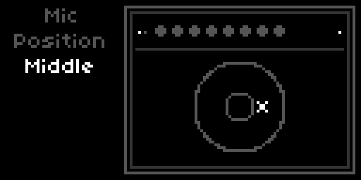

### Tape

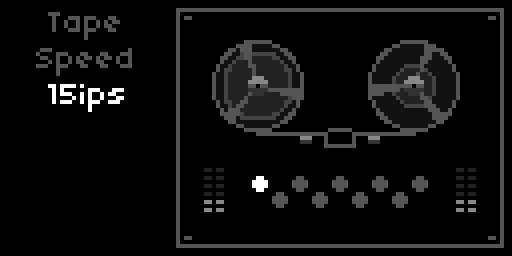

The whole mix passes over a tape head on its way out. Tape is less an effect than a material: it rounds the transients, thickens the low end, breathes a little hiss and never quite holds still. Stop it, and the music winds down with the reels.

| Parameter | Default | Range / Options |
|-----------|---------|-----------------|
| **Engage** | Active | Bypass / Active |
| **Stop/Start** | trigger | PARAMS and MAP |
| **Speed** | 15 ips | 7.5 ips / 15 ips / 30 ips |
| **Drive** | 5.0 | 0–10 |
| **Bias** | Normal | Under / Normal / Over |
| **Hiss** | 0.5 | 0–10 |
| **Wow** | 2.5 | 0–10 |
| **Magnetism** | 2.5 | 0–10 |
| **Azimuth** | 2.5 | 0–10 |
| **Spin Down** | 2.5 s | 0.1–5 s |
| **Spin Up** | 1.0 s | 0.1–5 s |

**Speed** sets the tape speed: slower tape has a lower, stronger head bump, an earlier treble rolloff, more wow and more hiss; 30 ips is the cleanest. **Drive** sets how hard the signal hits the tape. **Bias** under-biased is brighter and breaks up earlier and less symmetrically, over-biased darker and cleaner. **Hiss** sets the noise floor, **Wow** the slow pitch drift and fast flutter. **Magnetism** is the density of the magnetic layer: more saturation, more low-end bump, and treble that compresses as the level rises. **Azimuth** tilts the playback head, offsetting left against right in time for a slightly smeared, phasey stereo image.

**Stop/Start** stops the transport: the tape slows to a halt over **Spin Down**, the pitch falling with it, and comes back up to speed over **Spin Up**. K2 on the focused Tape does the same, and so does the Trigger action Tape: Stop/Start. Engaged and level-matched by default, so Tape colours the mix without making it louder. Speed, Drive, Bias, Hiss, Wow, Magnetism and Azimuth are Mod Rack targets; Tape: Toggle switches it in and out.

### Build

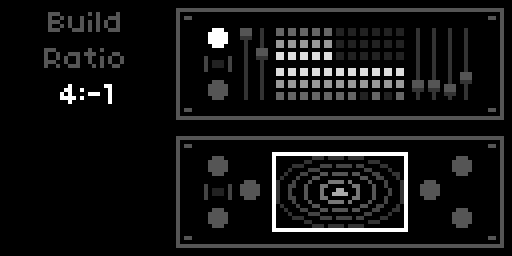

Two delay lines, side by side, whose lengths keep a fixed proportion, the second one free to run backwards. They remember in the way early digital delays did: the longer they reach, the fewer bits and the lower the sample rate they can spend. Feed them back into each other, let a repeat jump an octave now and then, and a single phrase builds into a slowly shifting architecture.

| Parameter | Default | Range / Options |
|-----------|---------|-----------------|
| **Engage** | Bypass | Bypass / Active |
| **Freeze** | Off | Off / On |
| **Spillover** | Off | Off / On |
| **Ratio** | 4:-1 | 1:1 / 1:2 / 2:1 / 2:3 / 3:2 / 3:4 / 4:3 / 1:-1 / 1:-2 / 2:-1 / 4:-1 |
| **Block** | 10 | 1–10 |
| **Time** | 10.00 s | 1 ms up to the Block's limit |
| **Feedback** | 50 % | 0–100 % |
| **Octave** | 10 % | 0–100 % |
| **Smear** | 10 % | 0–100 % |
| **Crossfeed** | 5 % | 0–100 % |
| **Mix** | 25 % | 0–100 % |
| **Spread** | 50 % | 0–100 % |
| **Low Cut** | 40 Hz | 10–1000 Hz |
| **High Cut** | 15000 Hz | 800–15000 Hz |
| **Sync** | Off | Off / 8/1 / 4/1 / 2/1 / 1/1 / 1/2 / 1/4 / 1/8 / 1/16 / 1/32 / 1/64 |
| **Sync Feel** | Note | Note / Dotted / Triplet |

**Ratio** sets the lengths of line A and line B relative to each other; **Time** is the length of the longer one. A negative second number plays line B's repeats in reverse. **Spread** pans A to the left and B to the right.

**Block** is the memory the lines run in. Each block caps Time: about 2.5, 6.3, 16, 40, 100, 250, 630 ms, 1.6, 4 and 10 s for blocks 1 to 10. Blocks 1 to 4 run at full sample rate and 16 bit; from block 5 the bit depth starts to fall and from block 6 the sample rate, down to 8 bit and a quarter of the rate at block 10, so long delays sound grainy and dark. **Time** steps in semitones up to the block's limit; changing Block keeps the time where it fits. Below 40 ms the lines turn into a pitched comb filter that rings with Feedback.

**Feedback** sets how long the repeats last. **Octave** is the chance, on each pass, that a repeat jumps an octave up or down. **Smear** diffuses and softly saturates the repeats inside the loop, so they blur as they recede. **Crossfeed** feeds each line partly from the other. **Mix** is an equal-power blend of dry and wet. **Low Cut** and **High Cut** filter the wet signal only.

**Sync** locks Time to the Norns clock (see [Synchronization](#synchronization)), still limited by the Block.

**Freeze** closes the input and keeps the lines cycling what they hold, an endless loop of the last repeats. **Spillover** decides what bypass does. With Spillover On, bypassing closes the input and lets the repeats ring out, and a frozen loop keeps playing until Freeze is released. With Spillover Off, bypass cuts the wet signal at once, Freeze stops acting, and re-engaging starts with empty lines.

K2 on the focused Build switches Freeze. Block, Ratio, Time, Feedback, Octave, Smear, Crossfeed, Mix, Spread, Low Cut and High Cut are Mod Rack targets; Build: Toggle and Build: Freeze are Trigger actions.

### Mesmerize

The last room in the chain, and the largest. Where the spring is a box of wire in the amp, Mesmerize is a figure-eight of slowly drifting echoes that can swell to a hall and beyond. Freeze it, and a chord hangs in the air while you play over it.

| Parameter | Default | Range / Options |
|-----------|---------|-----------------|
| **Engage** | Bypass | Bypass / Active |
| **Freeze** | Off | Off / On |
| **Spillover** | Off | Off / On |
| **Size** | 100 % | 10–300 % |
| **Pre-Delay** | 100 ms | 0–500 ms |
| **Decay** | 75 % | 0–100 % |
| **Damping** | 5 % | 0–100 % |
| **Tilt** | 0 % | −100–+100 % |
| **Mix** | 25 % | 0–100 % |
| **Spread** | 100 % | 0–200 % |
| **Diffusion** | 25 % | 0–95 % |
| **Saturation** | 0 % | 0–100 % |
| **Bandwidth** | 50 % | 0–100 % |
| **Low Cut** | 60 Hz | 20–1000 Hz |
| **Width** | 100 % | 0–200 % |

**Size** scales the whole tank, from a small chamber to far beyond a hall. **Pre-Delay** holds the reverb back behind the dry note. **Decay** sets how long the tail lasts, **Damping** how quickly its highs die away. **Tilt** tips the tone of the wet signal around 1 kHz: negative darker, positive brighter. **Mix** is an equal-power blend of dry and wet.

Under **Space**, **Spread** changes the proportions between the tank's delay lengths (100 % is the classic spacing) and **Diffusion** how densely the input is smeared before it enters the tank. Under **Tone & Stereo**, **Saturation** drives the feedback loop softly, **Bandwidth** low-passes the input (higher is brighter), **Low Cut** thins the wet low end, and **Width** sets the stereo width of the wet signal, from mono at 0 % to wider than the tank at 200 %.

**Freeze** closes the input and holds the tank at infinite decay. **Spillover** decides what bypass does. With Spillover On, bypassing closes the input and lets the tail ring out, and a frozen tank keeps sounding until Freeze is released. With Spillover Off, bypass cuts the wet signal at once and Freeze stops acting; re-engaging then starts with a fresh, empty tank instead of the moment that was cut off.

K2 on the focused Mesmerize switches Freeze. Size, Pre-Delay, Decay, Damping, Tilt, Mix, Spread, Saturation, Width and Low Cut are Mod Rack targets; Mesmerize: Toggle and Mesmerize: Freeze are Trigger actions.

### Sense

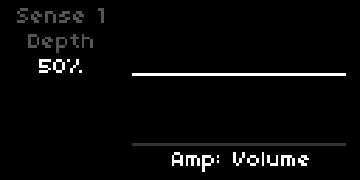

Two envelope followers (the **Sense** modules), each with the following parameters:

| Parameter | Default | Range / Options |
|-----------|---------|-----------------|
| **Engage** | Off | Off / On |
| **Depth** | 50 % | 0–100 % |
| **Direction** | + | + / − |
| **Slew** | 50 ms | 1–500 ms |
| **Freeze** | Off | Off / On |
| **Target Device** | - | device group |
| **Target Param** | - | parameter within device |

Each Sense module tracks the amplitude of the raw input signal, before the pedals. In Mono input mode the detector reads the left jack only; in Stereo input mode it reads `(L + R) × 0.5` so both channels drive the envelope together.

**Freeze** holds the modulation where it is: the Sense keeps listening but sends nothing new to its target until Freeze is off again. Short-press **K2** on the Sense in the Mod Rack switches it.

**Depth** scales the modulation contribution; at 100 % Sense can sweep the target across its full parameter range. **Direction** picks whether the modulation pushes the target upward from its base value (`+`) or downward (`−`). **Slew** sets the time constant of the amplitude detector itself, with the same value used for both attack and release: short Slew gives snappy, percussive tracking, long Slew gives a sluggish, smooth contour that ignores transients.

**Target Device** and **Target Param** select what Sense modulates. The device list and parameter list are the same as the Mod Rack's, minus parameters already claimed by another source. The ownership pool is shared with the Mod Rack: a target can be claimed by at most one LFO or one Sense module at a time, and it is claimed the moment a source points at it, even before that source is enabled. The claimed target's PARAMS entry carries the `(M)` prefix whether or not the source is running; enabling the source is what starts the value moving. Both Sense modules ship with no target (`-`); pick a Device and the first free parameter is selected automatically, and setting the Device back to `-` releases the target.

In the Mod Rack, a Sense shows the envelope it hears over the last three seconds, traced above and below a centre line, before Depth and Direction are applied. Short-press K3 on the pane to toggle Enable.

### Mod Rack

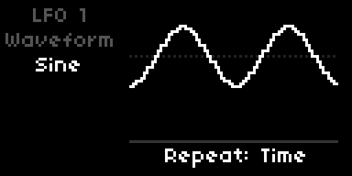

Eight LFOs, each with the following parameters:

| Parameter | Default | Range / Options |
|-----------|---------|-----------------|
| **Engage** | Off | Off / On |
| **Waveform** | Sine | Sine / Triangle / Saw / Square / Smooth Random / Stepped Random |
| **Rate** | 1.0 Hz | 0.1–25 Hz (exp) |
| **Depth** | 50 % | 0–100 % |
| **Direction** | +/- | + / - / +/- |
| **Phase** | 0° | 0° / 90° / 180° / 270° |
| **Steps** | 8 | 1–16 (Stepped Random only) |
| **Stability** | 50 % | 0–100 % (Stepped Random only) |
| **Sync** | Off | Off / 8/1 / 4/1 / 2/1 / 1/1 / 1/2 / 1/4 / 1/8 / 1/16 / 1/32 / 1/64 |
| **Sync Feel** | Note | Note / Dotted / Triplet (when Sync is active) |
| **Rate Slew** | 0 s | 0–5 s (non-Step-Random only) |
| **Target Device** | - | device group |
| **Target Param** | - | parameter within device |
| **Randomize** | - | trigger (Stepped Random only, in PARAMS / MAP) |

**Engage** starts the LFO moving its target. Ownership is claimed earlier, the moment the LFO points at a target: the device and parameter dropdowns filter out parameters already claimed by another LFO or Sense module, so two sources can never share a target. A claimed target's PARAMS entry carries the `(M)` prefix whether or not its owner is enabled. While the owner is disabled the value sits at its base and still responds to manual edits; while the owner is enabled the modulation drives it. Every source ships with no target (`-`); pick a Device and the first free parameter is selected automatically, and setting the Device back to `-` releases the target.

**Waveform** selects the LFO shape. Sine, Triangle, Saw, and Square are standard periodic waveforms. **Smooth Random** generates a band-limited random signal that interpolates smoothly between values at each cycle boundary. **Stepped Random** is a shift-register pattern generator: each clock step shifts the register and inserts a new bit.

**Rate** sets the LFO frequency. When **Sync** is set to a division, Rate is derived from the Norns clock (same formula as Tremolo and Warp; see [Synchronization](#synchronization)). While synced, the Rate parameter is hidden from the strip and replaced with the division name. **Sync Feel** applies the Note/Dotted/Triplet multiplier and is only visible when Sync is active.

**Rate Slew** smooths abrupt changes to the LFO rate (for example, when another LFO modulates this LFO's rate). The slew time is in seconds. Hidden for Stepped Random, which uses clock-based stepping.

**Direction** controls how the LFO value maps to the target range. **+** sweeps from base to base + depth. **-** sweeps from base to base − depth. **+/-** sweeps symmetrically around the base.

**Steps** (Stepped Random) sets the shift-register length in bits. A 1-bit register produces a coin-flip pattern; longer registers produce longer sequences before repeating. **Stability** controls how often the register feeds back its own most-significant bit (high Stability = more repetition) versus its complement (low Stability = more variation). At 50 % the output is uncorrelated. **Randomize** is a trigger in PARAMS and MAP that seeds the register with a random value; short-press K2 on the LFO's pane in the Mod Rack triggers the same action.

**Target Device** and **Target Param** select what the LFO modulates. The device list groups targets by signal-chain stage (Cut, Fray, Push, Distort, Warp, Repeat, Amp, Tremolo, Hold 1, Hold 2, Loop, Reverb, Cab, Count, LFO 1–8, Walk, Trigger, Tape, Build, Mesmerize). The parameter list shows only the parameters available within the selected device. Tremolo, Warp, and Repeat each expose both their Sync Division and Sync Feel as separate targets, so an LFO can shift a synced effect between Note, Dotted, and Triplet feel in real time. Loop exposes its Quantize division as a target alongside the level and speed controls. Count exposes its whole voice (Root, Register, Level, Length, Division, Scale, Chords, and Scale Play), so an LFO can transpose the metronome line, shift its octave, harmonise it, or resequence its scale-play mode. LFOs can modulate Rate, Depth, Phase, Steps, Stability, Rate Slew, Sync Division, and Sync Feel of other LFOs; routing LFO A into LFO B's rate while LFO B modulates a pedal parameter creates compound motion.

The target list adapts to the state of the destination. For another LFO, only the parameters relevant to its current waveform appear: Phase and Rate Slew on the periodic and smooth-random shapes, Steps and Stability on Stepped Random. Rate is hidden once the destination is synced. Sync Division and Sync Feel are exposed as targets only when sync is already active on the destination, on Tremolo, Warp, Repeat, the looper, and other LFOs alike, so modulation reshapes a sync grid that you have already chosen rather than switching sync on or off. A Sync or Quant target can never be moved to **Off** by modulation; only a manual edit can. If a destination changes in a way that retires the current target (the waveform changes, sync turns off, the synced rate disappears), the LFO falls back to the first parameter still available.

Every modulation source (LFO, Sense, Walk and Trigger) stores its target by name in the PSET, not by its position in the dropdown. The dropdowns only list free targets and so change order all the time; the name lets a PSET find the same target again on load. Older PSETs without names still load as before.

### Walk

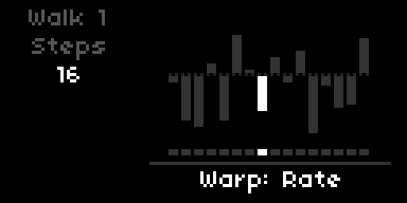

Two step sequencers (the **Walk** modules), each stepping through up to sixteen values and driving a chosen continuous parameter. Each has the following parameters:

| Parameter | Default | Range / Options |
|-----------|---------|-----------------|
| **Engage** | Off | Off / On |
| **Steps** | 16 | 2–16 |
| **Step 1 … Step 16** | 0 % | −100 – +100 % |
| **Rate** | 1.0 Hz | 0.1–25 Hz (exp) |
| **Sync** | Off | Off / 8/1 / 4/1 / 2/1 / 1/1 / 1/2 / 1/4 / 1/8 / 1/16 / 1/32 / 1/64 |
| **Sync Feel** | Note | Note / Dotted / Triplet (when Sync is active) |
| **Rate Slew** | 0 s | 0–5 s |
| **Target Device** | - | device group |
| **Target Param** | - | parameter within device |
| **Randomize** | - | trigger |

A Walk steps through its values in order at **Rate**, or locked to the Norns clock when **Sync** is set to a division, looping back to the first step after the last active one. **Steps** sets how many of the sixteen are used; the rest are skipped, and in the Mod Rack their knobs simply disappear while the used ones stay in place.

Each step is a bipolar amount from **−100 %** to **+100 %**, applied relative to the target parameter's current base value: **0 %** leaves the target untouched, **+100 %** drives it to its maximum, **−100 %** to its minimum. With a target of Amp Volume sitting at 2.5, a step at +100 % reaches 10, a step at −100 % reaches 0, and 0 % holds 2.5. The scaling is asymmetric by design, so ±100 % always lands exactly on the rail wherever the base sits.

**Rate Slew** smooths the jump between consecutive step values, gliding instead of hard-stepping. **Randomize** rolls fresh random values into all active steps; it is a trigger in PARAMS and MAP, and **K2** held for two seconds on the Walk in the Mod Rack does the same.

**Target Device** and **Target Param** pick what the Walk drives, from the same pool the LFOs and Sense modules use, minus parameters already claimed by another source. The ownership pool is shared: a target belongs to at most one LFO, Sense or Walk at a time. A Walk can also target another Walk's Rate, Steps, Rate Slew, Sync Division and Sync Feel; the two Walk modules appear in every source's device list as `Walk 1` and `Walk 2`, and triggers can fire `Walk N: Randomize`. As with every device, Sync Division and Sync Feel are modulation targets only once the Walk's own Sync is on.

In the Mod Rack, the Walk shows all sixteen steps as bars above and below a centre line, with a running light underneath; steps beyond Steps stay as dashed outlines of their stored values. The playing step lights up; a small dot marks the step selected for editing (E2 scrolls to a step, E3 sets its value). Short-press **K3** toggles the Walk on or off, short-press **K2** sends it back to step 1.

### Triggers

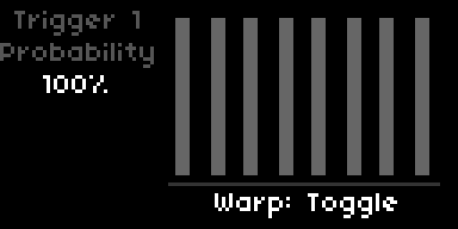

Four event triggers, each with the following parameters:

| Parameter | Default | Range / Options |
|-----------|---------|-----------------|
| **Engage** | Off | Off / On |
| **Probability** | 100 % | 0–100 % |
| **Rate** | 1.0 Hz | 0.1–25 Hz (exp) |
| **Sync** | Off | Off / 8/1 / 4/1 / 2/1 / 1/1 / 1/2 / 1/4 / 1/8 / 1/16 / 1/32 / 1/64 |
| **Sync Feel** | Note | Note / Dotted / Triplet |
| **Device** | Push (Trigger 1) ... Repeat (Trigger 4) | device group |
| **Target** | Toggle | action within device |

Triggers fire at a chosen rate and dispatch a single action per fire. **Probability** acts as a coin gate: 100 % fires every tick, 50 % fires roughly every other, 0 % is silent. **Engage** activates the trigger; while Off, no clock runs and no action fires.

**Rate** sets the firing frequency in free mode. When **Sync** is set to a division, Rate is hidden and the firing rhythm is derived from the Norns clock (same formula as Tremolo, Warp, and the LFOs; see [Synchronization](#synchronization)). Sync Feel applies the Note / Dotted / Triplet multiplier and stays visible alongside Sync Division.

**Device** and **Target** select what the trigger fires. Devices are grouped by signal-chain stage in the same order as the LFO target list (Cut, Fray, Push, Distort, Warp, Repeat, Amp, Tremolo, Hold 1, Hold 2, Loop, Reverb, LFO 1–8, Walk, Tape, Build, Mesmerize). Each pedal and effect device exposes a **Toggle** target that flips the device's bypass state; Hold 1 and Hold 2 add **Recapture**, which refreshes a running freeze, Tape adds **Stop/Start**, and Build and Mesmerize add **Freeze**, which switches their Freeze on and off. Each LFO device exposes a single **Randomize** target, available only when the destination LFO is in Stepped Random waveform; outside Stepped Random the target dropdown shows `-` and the trigger is a no-op. The Loop device exposes three targets: **Rec** advances the looper through its K3 transport order (idle → rec → play → dub → play …, with sample-mode retrig in play), **Clear** resets the loop unconditionally to idle and empties the buffer, and **Undo** takes back the last overdub.

Triggers guard their targets the same way the LFOs and Sense modules do, but in a pool of their own: no two triggers can fire the same action. Point one trigger at an action and it drops out of the other triggers' Device and Target dropdowns. The trigger pool is independent of the LFO and Sense pool, so a trigger can flip a pedal's bypass while an LFO modulates a parameter inside that same pedal. Each trigger ships with no target (`-`) and disabled by default; pick an action from the Device and Target dropdowns to assign one.

When a trigger targets `LFO N: Randomize` and is enabled, that LFO's internal Stepped Random clock is suspended and the trigger becomes the only source of new random steps. Disabling the trigger or pointing it elsewhere returns the LFO to its own internal stepping.

LFOs can modulate trigger Rate and Probability, and, while the trigger is synced, its Sync division and Sync Feel; the trigger devices appear in the LFO target list as `Trigger 1` through `Trigger 4`. Modulating Sync walks a trigger through the clock divisions without leaving the grid: a trigger on Loop: Rec then cuts loops of changing length that all land on the beat. Changing Sync or Sync Feel by hand while a source modulates it moves the centre of the modulation; switching Sync off releases the target and the source falls back to the trigger's next free target.

## Synchronization

When the Norns clock is running and a stage's **Sync** parameter is set to a division (anything except **Off**), the stage's rate parameter is derived from the BPM instead of its standalone value:

- Tremolo Speed → derived from BPM
- Warp Rate → derived from BPM
- Repeat Time → derived from BPM (`1000 / Hz` ms)
- Looper Quantization → snaps K2 transitions to the next beat boundary

The conversion is `beats = base_beats × feel_multiplier`, where:

| Division | base_beats |
|---|---|
| `8/1` | 32 |
| `4/1` | 16 |
| `2/1` | 8 |
| `1/1` | 4 |
| `1/2` | 2 |
| `1/4` | 1 |
| `1/8` | 0.5 |
| `1/16` | 0.25 |
| `1/32` | 0.125 |
| `1/64` | 0.0625 |

| Feel | feel_multiplier |
|---|---|
| Note | × 1.0 |
| Dotted | × 1.5 |
| Triplet | × 2/3 |

Resulting `Hz = BPM / (beats × 60)`. At 120 BPM: `1/4 Note` = 2 Hz, `1/4 Dotted` = 1.33 Hz, `1/4 Triplet` = 3 Hz.

Each effect's range still applies (Tremolo 0.1–25 Hz, Warp 0.1–25 Hz, Repeat 1–1000 ms). The encoder only lands on divisions the current BPM can actually reach: unreachable ones are skipped as you scroll, and if a tempo change pushes the active division out of range it snaps to the nearest reachable one. So at any BPM the strip only shows a division the effect can produce. A division forced out of range by other means (for example from the PARAMS menu) still dims on the encoder strip to flag the clamp.

When an LFO modulates the Time, Speed, or Rate of a synced effect, the modulation centres on the clock-derived value rather than the standalone parameter, so the wiggle tracks the synced time instead of collapsing toward the low manual base.

When the Norns clock source switches to **MIDI** (PARAMS > CLOCK > SOURCE), all four sync defaults activate automatically (`1/4` for Tremolo, Warp, Repeat, and Looper Quantization). Switching back to internal clock deactivates them. Stopping the clock holds the last derived values.

## Looper transport

```
idle ── K3 ──► rec ── K3 ──► play ── K3 ──► dub ── K3 ──► play …
                │
                └── K2 ──► idle (recording aborted, buffer cleared)

play / dub ── K2 ──► stop ── K2 ──► idle (buffer cleared)
stop ── K3 ──► play
play / dub / stop ── K2 held 2 s ──► undo last overdub (a running dub ends)
```

The loop keeps running when you open the tuner or pedalboard. Transport keys (K2, K3) are inactive in those views; the loop is not affected.

Transport icons at the bottom of the left display (framed in brackets when a looper parameter is selected):

- **●** recording
- **●+** overdubbing
- **▶** playing
- **■** stopped

## MIDI

Every parameter, bypass toggle, and looper transport action is available in the PARAMS menu and can be mapped to any MIDI CC using Norns' built-in MIDI learn.

### How to map a control

1. Open the PARAMS menu (press K1 from the main screen, navigate to PARAMS)
2. Scroll to the parameter or action you want to map
3. Press K3 to enter MIDI learn mode (the entry flashes)
4. Send a CC from your MIDI controller
5. Norns assigns that CC to the parameter; the mapping is saved with your PSET

### What can be mapped

**Route, Keys, the PARAMS groups of installed voices, Cut, Fray, the pedals, Amp, Tremolo, Hold 1 and 2, Loop, Reverb, Cab & Mic, Tape, Build, Mesmerize, Count.** All continuous parameters respond to CC values scaled to their parameter range.

**Enable toggles** (Amp, Reverb, Tremolo, Tape, Build, Mesmerize, Push, Distort, Warp, Repeat). CC ≥ 64 enables (Active), CC < 64 bypasses. **Cab Mode** is a 2-way option (Bypass / Cab & Mic Sim); the CC value is scaled to the option range.

**Synchronization.** Each stage's `Sync` (Tremolo / Warp / Repeat) and `Quantize` (Looper) is an option-type param mappable to a CC. Useful for tap-style division switching from a controller knob.

**Looper transport.** Each action is a trigger entry visible in both PARAMS and MAP:

| Entry | Action |
|---|---|
| Looper Rec/Play | Same as K3: idle → rec → play → dub → play … / stop → play |
| Looper Stop/Clear | Same as K2: play/dub → stop → idle (buffer cleared) |
| Looper Undo | Same as K2 held: undo the last overdub |

**Tap tempo.** Warp and Repeat each have a **Tap** trigger, the same as K2 on the focused effect. MAP only listens to CCs; a switch that sends notes cannot tap.

### Notes

- MIDI mappings are stored per PSET; each preset can have its own mapping.
- Triggers (looper Rec/Play, Stop/Clear and Undo, Tap, Hold Recapture, Tape Stop/Start, Randomize, Initialize) fire on any CC value above 0. A button that sends 127 on press and 0 on release fires once per press.
- **Enable toggles** use CC ≥ 64 for Active and CC < 64 for Bypass. Your controller must send both values (latch or bi-directional CC). A toggle that always sends CC 127 will set the param to Active forever.
- **After upgrading** from a pre-release build (pre-0.3), delete `dust/data/princeton/princeton.pmap` and re-map your CCs. The param type change from `add_binary` to `add_option` breaks saved mappings silently.
- CC mappings learn the channel along with the CC. Notes for a voice are a separate path: they are received on the port and channel set in KEYS > MIDI Device and MIDI Channel (default All and Omni), see [Keys](#keys).
- With **MIDI Pickup** on (GUI group, default), a mapped knob takes over only once it reaches the parameter's current value; with **Follow Focus** on, the screen jumps to whatever a mapped control moves. See [GUI](#gui).

## Install

Via Maiden: open `http://norns.local/maiden` and run:

```
;install https://github.com/notrobintaylor/princeton
```

Or via SSH:

```bash
ssh we@norns.local
cd ~/dust/code
git clone https://github.com/notrobintaylor/princeton
```

**NAM (optional).** princeton ships the NamAmp plugin in `lib/nam/`. On the first start it copies the plugin into `~/.local/share/SuperCollider/Extensions/princeton/`; restart norns once (SYSTEM > RESTART) so SuperCollider loads it. Put your `.nam` captures in `dust/data/princeton/nam/`. The same restart is needed after an update that changes the plugin. See [NAM](#nam).

**Voices (optional).** A voice mod goes into `~/dust/code/`, is enabled in **SYSTEM > MODS**, and needs one norns restart before it appears in Route. See [Voices](#voices).

## Credits

**Neural Amp Modeler.** The NAM mode of the Amp runs on [NeuralAmpModelerCore](https://github.com/sdatkinson/NeuralAmpModelerCore) by Steven Atkinson (MIT), with [Eigen](https://gitlab.com/libeigen/eigen) (MPL 2.0) and [nlohmann/json](https://github.com/nlohmann/json) by Niels Lohmann (MIT). The license texts ship with the plugin in `lib/nam/THIRD_PARTY_LICENSES.md`. Captures for every kind of amp are shared on [TONE3000](https://www.tone3000.com).

**Ideas borrowed from research.**
- Mesmerize's tank follows the plate reverberator in Jon Dattorro, "Effect Design, Part 1: Reverberator and Other Filters" (JAES, 1997).
- Fray and Distort clip without aliasing through antiderivative anti-aliasing, after Parker, Zavalishin and Le Bivic, "Reducing the Aliasing of Nonlinear Waveshaping Using Continuous-Time Convolution" (DAFx-16, 2016).
- The spring reverb's Drip uses a cascade of allpass filters for the dispersive chirp of a real spring, the idea behind Välimäki, Parker and Abel, "Parametric Spring Reverberation Effect" (JAES, 2010).
- The LFOs' Stepped Random is a shift register in the spirit of Tom Whitwell's Turing Machine (Music Thing Modular).

**Instruments that set the tone.** The amp, its bias tremolo and spring tank follow the Fender Princeton Reverb, the cabinet a Jensen 10" speaker. Fray leans on the Z.Vex Fuzz Factory, Distort on the Pro Co RAT, Repeat on the Malekko Echo 600. The looper draws on the Line 6 DL4, the Gibson Echoplex Digital Pro, the Torso S4 and the Glou Glou Loupé. None of them are affiliated with princeton; the names only say where the ears were pointed.
