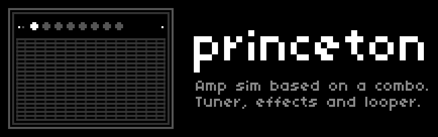
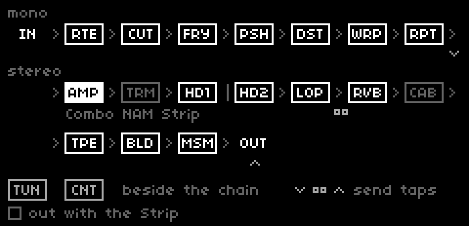
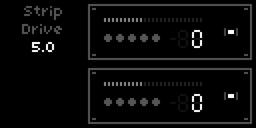
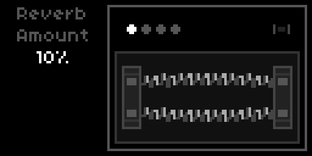
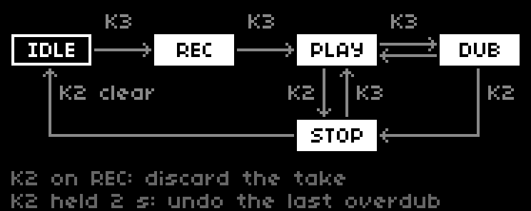
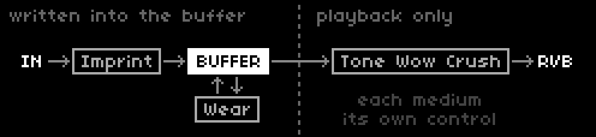

# princeton

### A guitar amp simulator, pedalboard and looper for Monome Norns

[](https://www.youtube.com/watch?v=VqkFejb8owY)

princeton is a guitar rig for Monome Norns. The amp sits in the middle: a small American combo from the early 1960s, recreated in code, with its bias tremolo and spring reverb. Six pedals come before it. After it, a 60-second stereo looper sits in front of the spring, so whatever you loop washes through the same reverb as the live string. Tape, a digital delay and a large reverb close the chain.

Plug a guitar into the left input. No preamp or interface required.

The looper carries the script. Six storage media (BBD, Cassette, CD, Chip, Tape, Vinyl) colour the loop: Imprint sets how much of that colour is baked in as you record, Wear how much further the loop erodes on every pass. The amp stays clean below Volume 3.5 and breaks up past 5.5; for harder distortion, reach for Fray, Push or Distort.

## Signal chain



Before the amp the chain is mono, or stereo with Route on Stereo or a voice; from the amp on it is stereo. The amp slot holds the combo, a NAM capture or the Strip, and with the Strip, Tremolo and Cab & Mic leave the chain. Tune and Count stand beside it: Tune listens to the raw input, Count makes its own click. The send taps mark where Send A and B can listen.

| Device | In short |
|---|---|
| [Route](#route) | What goes in (guitar, stereo line, a voice), Input Trim, two fx sends |
| [Tune](#tune) | Strobe tuner with a mute |
| [Count](#count) | Click track that can also play a small line in a scale |
| [Cut](#cut) | Noise gate; also swells and chops |
| [Fray](#fray) | Unstable fuzz that spits, chokes and sings |
| [Push](#push) | Compressor and overdrive in one |
| [Distort](#distort) | Hard clipper |
| [Warp](#warp) | Pitch vibrato, into chorus |
| [Repeat](#repeat) | Analog-style delay |
| [Amp](#amp) | The combo, a [NAM](#nam) capture, or the [Strip](#strip), a stereo pair of studio preamps |
| [Tremolo](#tremolo) | Bias tremolo, ping-ponging left and right |
| [Hold](#hold) | Two granular freezes in parallel |
| [Loop](#loop) | 60-second stereo looper with six media |
| [Reverb](#reverb) | Spring reverb over live signal and loop together |
| [Cab & Mic](#cab--mic) | 10" cabinet with three mic positions |
| [Tape](#tape) | Tape machine over the whole mix |
| [Build](#build) | Two digital delay lines in a ratio, one may run backwards |
| [Mesmerize](#mesmerize) | Large, slowly moving reverb tank |

Every device switches on and off on its own; Amp, Reverb, Cab & Mic and Tape are on by default, the rest off. The [Mod Rack](#mod-rack) adds eight LFOs, two envelope followers (Sense), two step sequencers (Walk) and four Triggers that can move almost any of these controls.

## Playing it

| Control | Function |
|---------|----------|
| **E1** | Move through the chain, device by device |
| **E2** | Select a parameter of the focused device |
| **E3** | Change its value |
| **K3** | Switch the focused device on or off (Loop: step the transport) |
| **K2** | The focused device's second function, see below |
| **K1 held 2 s** | Open or close the Mod Rack |
| **K1 + K3 held 2 s** | Add modulation to the focused parameter |

**E1** runs through every device in chain order: Route, Tune, Count, Cut, Fray, Push, Distort, Warp, Repeat, Amp, Tremolo, Hold 1, Hold 2, Loop, Reverb, Cab & Mic, Tape, Build, Mesmerize. Some share a view: Tune with Count, Cut with Fray, the pedals in pairs, the two Holds, Build above Mesmerize in a rack. Amp, Tremolo, Reverb and Cab & Mic all live in the cabinet, which is why E1 enters it twice, once before and once after Hold and Loop. Entering a device lands on the parameter you left it on.

**E2 reaches every parameter a device owns**, including those the panel has no knob for (Tremolo's Division and Feel, Reverb's shelves, Cab & Mic's Level). They show in the readout on the left while the panel highlight stays on the last real knob. When a modulation source moves the focused parameter, the readout shows the live value with a dim **M**; turn the knob and for two seconds it shows the base value you are setting, with a **B**.

**K2** by device:

| Device | K2 |
|---|---|
| Tune | Reference back to 440 Hz |
| Count, Warp, Repeat, Tremolo | Tap tempo (see [Tap tempo](#tap-tempo)) |
| Cut | Mute while held, a kill switch |
| Amp | Combo → NAM → Strip (NAM only when available) |
| Hold 1, Hold 2 | Recapture the freeze |
| Loop | Stop, then clear; held 2 s: undo the last overdub |
| Reverb, Build, Mesmerize | Freeze on / off |
| Cab & Mic | Next mic position |
| Tape | Stop / start the tape |
| Route, Fray, Push, Distort | Nothing |

On Route, K3 does nothing either: Route holds settings, not an effect.

### GUI modes


The **GUI** parameter sets how the screen behaves; it changes nothing in the audio path.

- **Studio** (default) draws each device as its own pedal, cabinet or rack unit and opens on the Amp. Every view uses the same frame on the right, so the outer edges never move as you walk. Devices carry no captions: the strip on the left names the one in focus, and in a pair the focused one shows its lit knob or a bright outline.
- **Stage** shows the whole chain on one screen as three-letter abbreviations joined by arrows, bright while on, dim while off, with a dot over the selected one. Route and Count are left out, since neither is an effect in the audio path. Opens on Tune.
- **Off** blanks the screen and ignores keys and encoders, for playing in the dark. Switch back from PARAMS or MIDI.

## One system for every control

Every knob in princeton, and in its voices, is one of five kinds, and each kind behaves the same wherever it appears:

- **Level**: anything that sets how loud something is, including the gate's Threshold and Range. It runs like a console fader from −75 to +10 dB (Threshold and Range to 0 dB), 1 dB a tick below −20 dB and 0.5 dB above; one tick below −75 dB is −inf, silence. 0 dB is always the device at its default loudness.
- **Drive**: the knobs that colour by pushing harder (Amp Volume, Push and Distort Gain, Fray Drive, Hold Gain, Tape Drive, Strip Drive), 0–10 in steps of 0.1.
- **Amount**: tone, mix, depth, feedback, size and their kin, 0–100 % (−100 to +100 % where they swing both ways) in steps of 1 %.
- **Rate, Frequency, Time**: round-number ladders that coarsen as the value grows. Rates go 0.1 Hz at a time up to 2 Hz, then 0.5 Hz to 10 Hz, then 1 Hz; filters go 5 Hz at a time to 100 Hz, then 25, 50, 250, 500 and 1000 Hz; times climb the same kind of ladder in milliseconds.
- **Steps**: choices, counts, semitones, BPM, the tuner's reference in whole hertz, Build's Time in semitones.

A control moves the same way wherever you turn it: the encoder in PARAMS, E3 on princeton's screens, a knob on lcx and a mapped MIDI CC all walk its own grid, and the readout shows exactly what PARAMS shows. A rate under a sync division steps through the divisions instead.

## Parameters

The sections follow the PARAMS menu, which follows the chain.

### GUI

| Parameter | Default | Range / Options |
|-----------|---------|-----------------|
| **GUI** | Studio | Studio / Stage / Off |
| **Follow Focus** | On | Off / On |
| **MIDI Pickup** | On | Off / On |
| **Initialize** | trigger | PARAMS and MAP |

**Follow Focus** lets the screen follow your controller: when a mapped MIDI control moves a parameter, the view jumps to it, and when a device is switched or the looper changes state from MIDI or PARAMS, the view moves to that device. Actions fired by Triggers never move the view.

**MIDI Pickup** is soft takeover for mapped CCs: a knob that doesn't match the current value does nothing until it reaches it, then takes over without a jump. **Initialize** sets every parameter back to its default; MIDI mappings stay.

### Route


| Parameter | Default | Range / Options |
|-----------|---------|-----------------|
| **Input** | Mono | Mono / Stereo / one entry per installed voice |
| **Input Trim** | 0 dB | Level |
| **Send A Source** | Output | Input / Loop / Output |
| **Send A Level** | 0 dB | Level |
| **Send B Source** | Output | Input / Loop / Output |
| **Send B Level** | 0 dB | Level |

**Mono** takes the left input at instrument level, for a guitar in the L jack. **Stereo** opens both inputs at line level (about 10 dB lower) and keeps the pedals and amp in stereo. A **voice** mutes the hardware inputs and feeds the chain in stereo from an instrument played over MIDI (see [Voices](#voices)). Turning the input to Stereo or a voice puts the [Strip](#strip) in the amp slot, and turning it back to Mono returns the amp you had; K3 on Route steps through the inputs.

**Input Trim** scales the signal before every pedal, so a MIDI expression pedal mapped to it is a volume pedal for the whole chain. The tuner and the Sense followers read the input ahead of the trim. A voice sets its own level in its PARAMS group.

**Send A** and **Send B** feed the two Norns send buses, which an fx mod reads in its send a or send b slot. Each taps one point: **Input** (the pedals' output, where it enters the amp), **Loop** (the looper alone) or **Output** (the full mix). The fx mod is optional; if one of its send buses lands on the Norns input or output, princeton gives that send a bus of its own while it runs, and the SuperCollider log in maiden says what it found.

On screen, Route is a white panel that draws the routing instead of knobs, both halves read from top to bottom. The left half shows the input: one jack splitting to L and R for Mono, two jacks for Stereo, a small module with a keyboard for a voice. The right half shows the sends: three taps, ∨ (Input), ∞ (Loop) and ∧ (Output), with a line from each chosen tap down to A and B; an unused tap is greyed out.


### Keys

The hands between the MIDI keyboard and a voice: Keys can hold a chord, restrike it on the clock like a mandolin tremolo, and lift every strike an octave higher. It only acts while Route's input is a voice.

| Parameter | Default | Range / Options |
|-----------|---------|-----------------|
| **Hold** | Off | Off / On |
| **Retrig** | Off | Off / On |
| **Retrig Division** | 1/16 | 1/4 / 1/8 / 1/16 / 1/32 |
| **Retrig Feel** | Note | Note / Dotted / Triplet |
| **Retrig Swing** | 50 % | 50–75 % |
| **Retrig Gate** | 50 % | 10–100 % |
| **Octaves** | 1 | 1 / 2 / 3 / 4 |
| **Octave Reset** | Off | Off / 1–64 strikes |
| **MIDI Device** | All | All / each connected port |
| **MIDI Channel** | Omni | Omni / 1–16 |

**Hold** keeps the chord after you let go; keys struck within 100 ms of each other join it, and the next chord replaces it. **Retrig** strikes the held keys again on every step of a clock grid; Swing delays every second step, Gate sets how long a strike sounds. The Retrig settings show only while Retrig is On.

**Octaves** moves every new strike one octave further up and folds back after that many; **Octave Reset** returns to the start after that many strikes. Velocity, aftertouch, pitch bend (±2 semitones) and the sustain pedal pass on to the voice. On the same port and channel, CCs **69** (Hold) and **70** (Retrig) switch at ≥ 64, **71** (Retrig Division) and **72** (Octaves) pick one of four options in quarters of the CC range, and **73** sets Octave Reset in strikes.

### Voices

A voice is a small instrument that lives outside princeton and plays through it. Voices come as norns mods, so princeton stays a guitar rig until you invite one in; chosen in Route, a voice stands where the guitar stood and runs through every pedal, the amp, the loop and the reverbs.

Copy the voice mod's folder to `~/dust/code/`, enable it in **SYSTEM > MODS** and restart norns, because its SuperCollider part only loads when SuperCollider starts. The voice then appears by name in Route's Input list, after Mono and Stereo, and its parameters get a PARAMS group of their own. A PSET stores the voice by name; if that voice is missing, the input falls back to Mono and the name is kept for the next save.

### Tune


| Parameter | Default | Range |
|-----------|---------|-------|
| **Mute** | Off | Off / On |
| **Reference** | 440 Hz | 420–460 Hz |

A strobe tuner: the note and octave in large type, a band below that drifts one way while you are flat and the other way while you are sharp, and stands still, with the lamp lit, once you are in tune. It runs its own pitch detector on a boosted copy of the raw input, because a passive guitar sits too low for the Norns pitch poll to track through the decay.

**Mute** silences the output like the footswitch on a tuner pedal; K3 switches it, and the Tune block stays lit as a reminder while it's on. The looper keeps playing under the mute.

### Count

| Parameter | Default | Range / Options |
|-----------|---------|-----------------|
| **Engage** | Off | Off / On |
| **BPM** | Norns tempo | 20–300 |
| **Division** | 1/4 | 1/1 / 1/2 / 1/4 / 1/8 / 1/16 |
| **Root** | C | C … B |
| **Register** | 3 | 0–7 |
| **Scale** | Off | Off / Chromatic / Major / Minor / Dorian / Pent Maj / Pent Min / Blues |
| **Scale Degree** | 1 | 1–15 |
| **Scale Play** | Off | Off / Forward / Reverse / 3rds / 4ths / 5ths / 7ths / Random |
| **Chords** | Off | Off / Octaves / Power Chords / Triads |
| **Level** | 0 dB | Level |
| **Length** | 50 ms | 1–500 ms |
| **Position** | Parallel | Parallel / Inline |

A click that can become a small voice. Each click is a short sine burst at **Root** and **Register** (C3 by default); **Length** runs from a tight tick to a tone. **Position** decides where it enters: **Parallel** goes straight to the output, **Inline** runs through the whole chain, so a click during a recording lands in the loop.

**BPM** is a real tempo knob: with the internal clock it sets the Norns tempo, and every synced device follows; with MIDI clock it shows the incoming tempo and takes over when the clock stops. **Division** sets the click against that tempo.

**Scale** turns the click into a note pool rooted at Root; at Off only the Root sounds. **Scale Degree** picks the step of the scale the click plays. **Scale Play** walks through the scale one step per click (up, down, in thirds to sevenths, or at random) and hides while Scale is Off. **Chords** stacks an octave, a fifth or a triad on every note, diatonic when a scale is set. All of it is a Mod Rack target, so an LFO on Root transposes the line and a slow one on Scale Play reshapes it.

### Cut


| Parameter | Default | Range / Options |
|-----------|---------|-----------------|
| **Engage** | Off | Off / On |
| **Threshold** | −50 dB | Level, to 0 dB |
| **Attack** | 1 ms | 0.1 ms–2.5 s |
| **Hold** | 20 ms | 1 ms–2.5 s |
| **Release** | 100 ms | 1 ms–2.5 s |
| **Range** | −75 dB | Level, to 0 dB |
| **Margin** | 0 dB | 0–25 dB in 0.5 dB steps |
| **Detection** | Peak | Peak / RMS |

A noise gate in front of the pedals. The signal must rise above **Threshold** to open it; **Range** is how far it drops when closed, so −inf mutes and −12 dB only ducks. **Hold** keeps it open a moment after the signal falls, **Margin** sets how far the signal must fall back below Threshold before it closes, and **Detection** picks a snappy Peak or a smoother RMS follower.

The wide ranges make it an instrument too: a long Attack is a slow-gear swell on every note, fast Attack and Release with a short Hold chop percussively, and an LFO on Threshold synced to the clock gates in rhythm.

### Fray

| Parameter | Default | Range / Options |
|-----------|---------|-----------------|
| **Engage** | Off | Off / On |
| **Drive** | 7.5 | 0–10 |
| **Comp** | 50 % | 0–100 % |
| **Stab** | 0 % | 0–100 % |
| **Octave** | 0 % | 0–100 % |
| **Oct Mode** | Up | Down / Up / Both |
| **Gate** | 0 % | 0–100 % |
| **Tone** | 100 % | 0–100 % |
| **Level** | 0 dB | Level |

A deliberately unstable fuzz. Where Push compresses and Distort clips, Fray is a starved circuit that spits, chokes and, pushed far enough, sings on its own.

**Drive** is the fuzz gain, from a rough edge to a full square. **Comp** starves the bias, more so as a note dies away, so the tail splutters instead of fading evenly. **Stab** collapses the supply and feeds the stage back into itself: a sag and bloom at low settings, a resonance that rings on after you stop near the top.

**Octave** blends in an added octave, and **Oct Mode** picks which: **Up** rectifies for the classic octave fuzz (clearest at moderate Drive), **Down** divides for a sub-octave that follows your dynamics, **Both** stacks the two. **Gate** chokes the decay, listening to the input rather than the fuzz. **Tone** is a low-pass from 7.5 kHz down to 750 Hz. An LFO on Gate stutters, one on Stab makes the circuit wander in and out of oscillation.

### Push


| Parameter | Default | Range / Options |
|-----------|---------|-----------------|
| **Engage** | Off | Off / On |
| **Gain** | 5.0 | 0–10 |
| **Tone** | 50 % | 0–100 % |
| **Level** | 0 dB | Level |
| **Comp** | 50 % | 0–100 % |

A compressor and an overdrive in one: the signal is squeezed, then driven into soft saturation. **Comp** sets how hard it squeezes, from letting the pick attack through to a steady sustain; the gain reduction follows the envelope of your playing, not each wave. **Tone** tilts the voice around 700 Hz, from warm to cutting.

### Distort

| Parameter | Default | Range / Options |
|-----------|---------|-----------------|
| **Engage** | Off | Off / On |
| **Gain** | 5.0 | 0–10 |
| **Tone** | 75 % | 0–100 % |
| **Level** | 0 dB | Level |
| **Low Cut** | 20 Hz | 20–1000 Hz |

Hard clipping. **Tone** sweeps a low-pass from 300 Hz (murky) to 5 kHz (cutting), **Low Cut** clears the sub-bass that piles up after the drive.

At their default Level, Fray, Push and Distort each sit about 1 dB above the clean amp, a slight lift rather than a jump; pull Level down as the gain goes up.

### Warp


| Parameter | Default | Range / Options |
|-----------|---------|-----------------|
| **Engage** | Off | Off / On |
| **Rate** | 2.5 Hz | 0.1–25 Hz |
| **Depth** | 25 % | 0–100 % |
| **Rise/Fall** | 2.5 s | 10 ms–5 s |
| **Mix** | 100 % | 0–100 % |
| **Division** | Off | Off / 8/1 … 1/64 |
| **Feel** | Note | Note / Dotted / Triplet |
| **Tap Division** | 1/4 | 8/1 … 1/64 |
| **Tap Feel** | Note | Note / Dotted / Triplet |
| **Tap** | trigger | PARAMS and MAP |

Pitch vibrato from a modulated delay. At 100 % **Mix** it is pure vibrato; blending in the dry signal moves it toward chorus. **Rise/Fall** is how long the effect takes to swell in when engaged and to fade when bypassed.

### Repeat

| Parameter | Default | Range / Options |
|-----------|---------|-----------------|
| **Engage** | Off | Off / On |
| **Time** | 500 ms | 1–1000 ms |
| **Feedback** | 50 % | 0–100 % |
| **Level** | 0 dB | Level |
| **Tone** | Bright | Bright / Dark |
| **Mod Depth** | 10 % | 0–100 % |
| **Mod Rate** | 2.5 Hz | 0.1–25 Hz |
| **Division** | Off | Off / 8/1 … 1/64 |
| **Feel** | Note | Note / Dotted / Triplet |
| **Tap Division** | 1/4 | 8/1 … 1/64 |
| **Tap Feel** | Note | Note / Dotted / Triplet |
| **Tap** | trigger | PARAMS and MAP |

An analog-style bucket-brigade delay with jitter and saturation in the feedback path. **Tone** picks a brighter or darker repeat; **Mod Depth** and **Mod Rate** wobble the delay time.

### Amp


| Parameter | Default | Range / Options |
|-----------|---------|-----------------|
| **Engage** | On | Off / On |
| **Amp** | Combo | Combo / NAM / Strip |
| **Model** | first capture | one entry per `.nam` file (NAM) |
| **Cab Sim** | Auto | Auto / On / Off (NAM) |
| **Volume** | 5.0 | 0–10 (Combo, NAM) |
| **Bass** | 50 % | 0–100 % (Combo, NAM) |
| **Mid** | 50 % | 0–100 % (NAM) |
| **Mid Freq** | 750 Hz | 250–4000 Hz (NAM) |
| **Treble** | 50 % | 0–100 % (Combo, NAM) |
| **Master** | 0 dB | Level (Combo, NAM) |
| **Rectifier** | Tube 5U4 | Tube 5Y3 / Tube 5U4 / Silicon (Combo) |
| **Drive** | 5.0 | 0–10, −10 to +10 dB (Strip) |
| **Even Harmonics** | 0 % | 0–100 % (Strip) |
| **Odd Harmonics** | 50 % | 0–100 % (Strip) |
| **Low Cut** | 80 Hz | 20–1000 Hz (Strip) |
| **High Cut** | 12 kHz | 1–20 kHz (Strip) |
| **Level** | 0 dB | Level (Strip) |

A small American combo. Volume below 3.5 stays clean; past 5.5 it breaks up, so single coils clip lightly at the default when you dig in. **Bass** and **Treble** give the open Fender voice at 50 % and cut when turned down; the mid scoop is fixed. Switching the amp off also dims the panel lamp.

**Rectifier** sets how far the supply sags when you dig in. **Tube 5Y3** sags deepest and slowest, with the least headroom and the earliest break-up; **Tube 5U4** is the default; **Silicon** barely sags, for a tighter attack and a firm low end. The three are level-matched, so switching changes the feel, not the volume.

#### Strip



The combo can step aside for a studio channel strip, the way a synth or a DI'd guitar goes straight to the desk. Two slim preamp units take its place, the left channel above the right, linked like a stereo pair: one set of controls drives both. Each unit shows its output on an LED bar, whose top segment lights once the stage starts rounding off, and its Drive in the dB it adds.

**Odd Harmonics** sets how early the stage rounds its peaks symmetrically, the bright, glassy grain of a console. **Even Harmonics** leans the curve to one side for the warmer second harmonic of a transformer. Both come before the cuts, which sweep without steps at 12 dB per octave.

At 0 dB the Strip is as loud as the combo at its default knobs; played much harder it comes out a little hotter, because it doesn't compress the way a small combo does. The Strip has no tremolo and no speaker, so Tremolo and Cab & Mic leave the chain while it plays, and the Reverb turns into a spring tank: its knobs and the Freeze LED on top, two springs below that swing with the reverb.



#### NAM

A Neural Amp Modeler capture is a snapshot of a real amp, pedal or rig, learned from recordings of it. princeton plays it in place of its own preamp and power stage and keeps its tone controls around it.

| Step | |
|---|---|
| **Captures** | Put `.nam` files in `dust/data/princeton/nam/` (created on the first start). |
| **Install** | On every start princeton checks its NamAmp plugin in `~/.local/share/SuperCollider/Extensions/princeton/` and copies it there if it is missing or has changed. After a copy, restart norns once (SYSTEM > RESTART). |
| **Check** | The SuperCollider log in maiden reads `princeton: NAM available` or `not available`. |

NAM appears in the **Amp** list only when the plugin is loaded and at least one capture is present. **Model** then lists the capture files, without the prefix they all share; it is also the first parameter on the Amp, so E3 flips through captures, each loading once the knob rests for a quarter second. The strip shows the capture's place in the list (3/9); the full names are in PARAMS.


**Volume** drives the capture's input from −12 to +12 dB. **Bass** and **Treble** are shelves at 250 Hz and 2.5 kHz, **Mid** a bell at **Mid Freq**, all flat at 50 %. **Cab Sim** decides whether Cab & Mic stays in the chain: **Auto** removes it when the capture already includes a cabinet, **On** always keeps it, **Off** always removes it.

### Tremolo

| Parameter | Default | Range / Options |
|-----------|---------|-----------------|
| **Engage** | Off | Off / On |
| **Speed** | 2.5 Hz | 0.1–25 Hz |
| **Intensity** | 0 % | 0–100 % |
| **Division** | Off | Off / 8/1 … 1/64 |
| **Feel** | Note | Note / Dotted / Triplet |
| **Tap Division** | 1/4 | 8/1 … 1/64 |
| **Tap Feel** | Note | Note / Dotted / Triplet |
| **Tap** | trigger | PARAMS and MAP |

Bias tremolo at the amp's output, alternating between left and right. Switch it on and turn up **Intensity**: up to 15 % the dry signal fades as the tremolo blends in, past that it's pure tremolo with rising depth, peaks always at full level. With a **Division** set, the strip shows the division (`1/8`, `1/4.`) instead of Hz.

### Hold


Two granular freezes, **Hold 1** and **Hold 2**, in parallel after the Tremolo. Engaging one grabs the last 1.2 seconds or so you played and sustains it as a pad of grains while the live signal keeps passing underneath. Because the grains read a frozen snapshot, the pad never loops audibly and can be transposed without running out.

The pads go into the looper with the live signal, so recording or overdubbing while one sounds prints it into the loop; a loop that only plays leaves it out. The Hold recorder hears only the live signal, so a new freeze never captures the pad still sounding.

| Parameter | Default (Hold 1 / Hold 2) | Range / Options |
|-----------|---------|-----------------|
| **Engage** | Off | Off / On |
| **Recapture** | trigger | PARAMS and MAP |
| **Size** | 50 % / 75 % | 0–100 % |
| **Density** | 45 % / 70 % | 0–100 % |
| **Spread** | 50 % / 75 % | 0–100 % |
| **Movement** | 25 % | 0–100 % |
| **Pitch** | −12 st / +12 st | −24 to +24 st |
| **Pitch Mix** | 10 % | 0–100 % |
| **Reverse Mix** | 0 % | 0–100 % |
| **Shape** | Smooth | Smooth / Soft / Swell / Pluck / Plateau |
| **Resolution** | Fine | Coarse / Fine |
| **Gain** | 5.0 | 0–10 |
| **Level** | 0 dB | Level |
| **Rise** | 250 ms | 10 ms–5 s |
| **Fall** | 2.5 s | 10 ms–5 s |

The pad fades in over **Rise** and out over **Fall**; engaging again during a Fall crossfades the old pad into the new one. **Recapture** does the same while the Hold stays on: it grabs a fresh freeze and fades the old one out, with no gap.

**Size** is the grain length, **Density** how thickly grains overlap, **Spread** how widely their onsets scatter. **Movement** lets those three drift on slow random curves around your settings, by up to a quarter of their range at 100 %; the readout shows the moving value with an **M**. **Gain** drives the pad into soft saturation, **Level** places it in the mix.

**Pitch** transposes in semitones, and **Pitch Mix** sets how many grains are transposed, so the default sprinkles a few octave grains over the pad. **Reverse Mix** does the same for grains played backwards. **Shape** is the grain window: Smooth is neutral, Soft gentler, Swell rises and cuts off like reverse tape, Pluck attacks and tails off, Plateau is nearly flat for the densest pad. **Resolution** Coarse saves CPU and only sounds grainier when Pitch is in use.

The two Holds start out different (Hold 2 larger, denser and pitched up where Hold 1 is pitched down), so running both layers two complementary freezes.

### Loop


| Parameter | Default | Range / Options |
|-----------|---------|-----------------|
| **Step Order** | Rec·Play·Dub | Rec·Play·Dub / Rec·Dub·Play |
| **Play From** | Start | Start / Cue |
| **Mode** | Overdub | Overdub / Overwrite / Sample / Resample |
| **Direction** | Forward | Forward / Reverse / Pendulum / Random |
| **Rec Level** | −2.5 dB | Level |
| **Play Level** | −2.5 dB | Level |
| **Fade Level** | −2.5 dB | Level |
| **Speed** | 0 % | −100 to +100 % |
| **Speed Mode** | Octaves | Octaves / Free |

A 60-second stereo buffer after the Holds and before the spring, so anything you record sits in the same reverb as the live string.

**K3** steps the transport the moment it goes down, so a take starts and ends where your finger lands. **Step Order** picks the sequence after the first take: record → play → dub → play … or record → dub → play …. **K2** stops, and a second K2 clears. **K2 held for two seconds** undoes the last overdub, sample-exact and without a click; it is one level deep, and an undo during a running dub ends that dub. The loop keeps running while you visit other devices.



The strip shows the state at the bottom left: **●** recording, **●+** overdubbing, **▶** playing, **■** stopped.

**Play From** decides where playback resumes after a stop: the **Start** of the loop, or the **Cue** where it stopped. **Mode** sets what a dub does: **Overdub** layers, **Overwrite** replaces, **Sample** plays once per K3 from the Play From position, **Resample** records the loop's own output back in, ageing and all. **Direction** runs forward, backward, back and forth (**Pendulum**) or flips at random at each boundary.

**Rec Level** sets the recording gain, **Play Level** the playback, **Fade Level** the gain across the crossfade at the loop's seam. **Speed** affects recording and playback alike: in **Octaves** it snaps to half speed, normal and double; in **Free** it moves continuously.

#### Medium

| Parameter | Default | Range / Options |
|-----------|---------|-----------------|
| **Medium** | Chip | BBD / Cassette / CD / Chip / Tape / Vinyl |
| **Imprint** | 10 % | 0–100 % |
| **Wear** | 5 % | 0–100 % |
| **BBD Tone** | Bright | Bright / Dark |
| **Cassette Wow** | 5 % | 0–100 % |
| **CD Errors** | 0 % | 0–100 % |
| **Chip Crush** | 0 % | 0–100 % |
| **Tape Wow** | 5 % | 0–100 % |
| **Vinyl Noise** | 10 % | 0–100 % |

**Medium** is the storage the loop pretends to be, and it works in two layers. The base character (filtering and saturation) is written into the buffer: **Imprint** sets how strongly it colours a take as it lands, **Wear** how much further each pass erodes it. Each medium's own control colours only the playback, so it changes a loop recorded minutes ago and can be turned back. With Imprint and Wear at 0, the buffer holds your playing clean.

Each medium is its own looper, so the Medium is fixed for the life of a loop: changing it clears the loop.

- **BBD** limits the bandwidth and saturates. **BBD Tone** is the one control on both sides: it sets the bandwidth baked in and also filters playback, so a loop can be darkened live but not brightened past what was baked.
- **Cassette** is band-passed with misbias saturation and crinkle; **Cassette Wow** adds wow and flutter.
- **CD** records almost pristine and only dulls slowly over passes. **CD Errors** sets how often playback skips, stutters on a short region or drops out.
- **Chip** reduces bit depth and sample rate, aliasing included, like an early sampler; **Chip Crush** adds a live bitcrusher.
- **Tape** softens, saturates and prints through; **Tape Wow** adds wow and flutter.
- **Vinyl** rolls off the highs and warbles like a warped record; **Vinyl Noise** adds crackle over a low dust haze.



#### Quantization

| Parameter | Default | Range / Options |
|-----------|---------|-----------------|
| **Quantize Division** | Off | Off / 8/1 … 1/64 |
| **Quantize Feel** | Note | Note / Dotted / Triplet |

With the Norns clock running and a division set, every transport step waits for the next boundary of that grid. Off is free-running.

### Reverb

| Parameter | Default | Range / Options |
|-----------|---------|-----------------|
| **Engage** | On | Off / On |
| **Amount** | 10 % | 0–100 % |
| **Length** | 2.5 s | 0.5–5 s |
| **Low Shelf** | 0 % | −100 to +100 % (±5 dB) |
| **High Shelf** | 0 % | −100 to +100 % (±5 dB) |
| **Dwell** | 50 % | 0–100 % |
| **Drip** | 50 % | 0–100 % |
| **Freeze** | Off | Off / On |

A spring tank over the live signal and the loop together, in stereo through an allpass diffuser. **Amount** sets send and decay together, and the default 10 % sits it behind the guitar; **Length** stretches the decay on its own, for a long ring without more signal in the tank. The shelves at 250 Hz and 3.5 kHz colour the wet path.

**Dwell** is how hard the springs are driven: more grows denser and saturates gently. **Drip** is the dispersive chirp a spring makes when a hard attack hits it, the wet surf "boing". **Freeze** closes the input and lets the springs ring on.

### Cab & Mic

| Parameter | Default | Range / Options |
|-----------|---------|---------|
| **Engage** | On | Off / On |
| **Position** | Middle | Center / Middle / Edge |
| **Level** | 0 dB | Level |

A 10" Jensen-style cabinet with a mic at three **Positions**: Center is brightest, Middle balanced, Edge darker and rounder. While Position is selected, the grill shows the speaker from the front with an X where the mic stands. Switch it off for a raw DI tone or to feed a real cabinet.


### Tape


The whole mix passes over a tape head. Tape is less an effect than a material: it rounds transients, thickens the low end, breathes a little hiss and never quite holds still. Stop it, and the music winds down with the reels.

| Parameter | Default | Range / Options |
|-----------|---------|-----------------|
| **Engage** | On | Off / On |
| **Stop/Start** | trigger | PARAMS and MAP |
| **Speed** | 15 ips | 7.5 ips / 15 ips / 30 ips |
| **Drive** | 5.0 | 0–10 |
| **Bias** | Normal | Under / Normal / Over |
| **Hiss** | 5 % | 0–100 % |
| **Wow** | 25 % | 0–100 % |
| **Magnetism** | 25 % | 0–100 % |
| **Azimuth** | 25 % | 0–100 % |
| **Spin Down** | 2.5 s | 100 ms–5 s |
| **Spin Up** | 1 s | 100 ms–5 s |

Slower tape has a stronger head bump, earlier treble loss, more wow and more hiss; 30 ips is the cleanest. **Drive** is how hard the signal hits the tape. Under-**Bias** is brighter and breaks up earlier, over-bias darker and cleaner. **Hiss** is the noise floor, **Wow** slow drift and fast flutter, **Magnetism** the density of the coating: more saturation and low end, treble that compresses as the level rises. **Azimuth** tilts the head, smearing left against right.

**Stop/Start** brings the reels to a halt over **Spin Down**, the pitch falling with them, and back up over **Spin Up**. Tape is level-matched, so it colours the mix without making it louder.

### Build


Two delay lines side by side whose lengths keep a fixed proportion, the second free to run backwards. They remember the way early digital delays did: the further they reach, the fewer bits and the lower the sample rate they can spend. Feed them into each other, let a repeat jump an octave now and then, and a phrase builds into a slowly shifting architecture.

| Parameter | Default | Range / Options |
|-----------|---------|-----------------|
| **Engage** | Off | Off / On |
| **Freeze** | Off | Off / On |
| **Spillover** | Off | Off / On |
| **Ratio** | 4:-1 | 1:1 / 1:2 / 2:1 / 2:3 / 3:2 / 3:4 / 4:3 / 1:-1 / 1:-2 / 2:-1 / 4:-1 |
| **Block** | 10 | 1–10 |
| **Time** | 10 s | 1 ms up to the Block's limit, in semitones |
| **Feedback** | 50 % | 0–100 % |
| **Octave** | 10 % | 0–100 % |
| **Smear** | 10 % | 0–100 % |
| **Crossfeed** | 5 % | 0–100 % |
| **Mix** | 25 % | 0–100 % |
| **Spread** | 50 % | 0–100 % |
| **Low Cut** | 40 Hz | 20–1000 Hz |
| **High Cut** | 15 kHz | 1–20 kHz |
| **Division** | Off | Off / 8/1 … 1/64 |
| **Feel** | Note | Note / Dotted / Triplet |

**Ratio** sets the lengths of line A and line B against each other, and **Time** is the longer one; a negative second number plays B backwards. **Spread** pans A left and B right.

**Block** is the memory the lines run in, and it caps Time: about 2.5, 6.3, 16, 40, 100, 250, 630 ms, 1.6, 4 and 10 s for blocks 1 to 10. Up to block 4 they run at full rate and 16 bit; from there bits and then sample rate fall, to 8 bit at a quarter rate in block 10, so long delays sound grainy and dark. Below 40 ms the lines become a pitched comb that rings with Feedback. **Division** locks Time to the clock, still within the Block.

**Octave** is the chance that a repeat jumps an octave, **Smear** blurs and softly saturates the repeats as they recede, **Crossfeed** feeds each line from the other. The cuts filter the wet signal only.

**Freeze** closes the input and keeps the lines cycling what they hold. **Spillover** decides what switching off does: On lets the repeats ring out (a frozen loop keeps playing until Freeze is released), Off cuts them at once and starts empty next time.

### Mesmerize

The last device and the largest room. Where the spring is a box of wire in the amp, Mesmerize is a figure-eight of slowly drifting echoes that swells to a hall and beyond. Freeze it, and a chord hangs in the air while you play over it.

| Parameter | Default | Range / Options |
|-----------|---------|-----------------|
| **Engage** | Off | Off / On |
| **Freeze** | Off | Off / On |
| **Spillover** | Off | Off / On |
| **Size** | 30 % | 0–100 % |
| **Pre-Delay** | 100 ms | 0–500 ms |
| **Decay** | 75 % | 0–100 % |
| **Damping** | 5 % | 0–100 % |
| **Tilt** | 0 % | −100 to +100 % |
| **Mix** | 25 % | 0–100 % |
| **Spread** | 50 % | 0–100 % |
| **Diffusion** | 25 % | 0–100 % |
| **Saturation** | 0 % | 0–100 % |
| **Bandwidth** | 50 % | 0–100 % |
| **Low Cut** | 60 Hz | 20–1000 Hz |
| **Width** | 50 % | 0–100 % |

**Size** scales the tank from a small chamber to far beyond a hall, **Pre-Delay** holds the reverb back behind the note, **Decay** sets how long the tail lasts and **Damping** how fast its highs die. **Tilt** tips the wet tone around 1 kHz, darker below zero, brighter above.

**Spread** changes the proportions between the tank's delay lengths, with the classic spacing at 50 %, and **Diffusion** how densely the input is smeared before it enters. **Saturation** drives the feedback loop softly, **Bandwidth** low-passes the input, **Low Cut** thins the wet low end, and **Width** runs from mono at 0 % through the tank's own width at 50 % to wider still. **Freeze** and **Spillover** work as on Build.

### Mod Rack


Modulation is added where it is needed. Hold **K1 and K3** together for two seconds on a parameter and a chooser asks how to move it: **Modulate** (an LFO), **Sense**, **Walk** or **Trigger**, each shown with its picture running. **K3** takes it: the next free slot of that kind is patched to the parameter (a Trigger to the device, starting with its first free action), switched on and opened in the rack. A kind with every slot taken reads *full*. If a source already drives the parameter, the chooser offers **Edit** and **Remove** instead; **K2** leaves without changes.


**K1 held for two seconds** opens and closes the rack. It shows only what is patched, in the order Sense, LFO, Walk, Trigger, or **Empty**. Each source fills the screen with its picture, its target on the line beneath:

- an **LFO** draws its live output over the last two cycles, so Depth, Direction, slew and clipping at the range ends all show;
- a **Sense** draws the envelope it hears over the last three seconds;
- a **Walk** shows its sixteen steps as bars with a running light, unused steps as faint ghosts;
- a **Trigger** shows its last eight rolls, a filled bar for each fire, an empty frame where Chance let one pass.

In the rack **E1** moves between sources, **E2** picks a parameter, **E3** changes it, and **K3** switches the source on and off. A short **K2** is its second function: an LFO restarts its cycle, a Sense freezes, a Walk returns to step 1, a Trigger fires by hand. **K2** held two seconds re-rolls a Stepped Random register or a Walk's steps. Removing a source returns it to its factory settings, so the next one starts fresh.

**One owner per target.** An LFO, Sense or Walk claims its target as soon as it points at it, even while switched off, so two sources never fight over one parameter; the target lists only offer what is free. A claimed parameter carries **(M)** in PARAMS, and while its source is off it rests at its base value and takes manual edits. Triggers keep a pool of their own, so a Trigger can switch a pedal while an LFO moves a knob inside it. Every source stores its target by name in the PSET, so it finds it again however the lists have shifted.

**What can be moved.** Almost every continuous control of the chain, Count's whole voice, and the sources themselves: an LFO can drive another LFO's Rate or Depth, or a Walk's Rate, for compound motion. The lists adapt to the destination: a Division or Feel is offered only once that device is synced, and modulation never switches a sync to Off. If a target goes away (a shape changes, a sync is switched off), the source moves to the next one still available.

#### LFO

| Parameter | Default | Range / Options |
|-----------|---------|-----------------|
| **Engage** | Off | Off / On |
| **Shape** | Sine | Sine / Triangle / Saw / Square / Smooth Random / Stepped Random |
| **Rate** | 1 Hz | 0.1–25 Hz |
| **Depth** | 50 % | 0–100 % |
| **Direction** | +/- | + / - / +/- |
| **Phase** | 0° | 0° / 90° / 180° / 270° |
| **Steps** | 8 | 1–16 (Stepped Random) |
| **Stability** | 50 % | 0–100 % (Stepped Random) |
| **Rate Slew** | 0 ms | 0–5 s |
| **Division** | Off | Off / 8/1 … 1/64 |
| **Feel** | Note | Note / Dotted / Triplet |
| **Target Device** | - | |
| **Target Param** | - | |
| **Randomize** | trigger | Stepped Random, PARAMS and MAP |

Eight LFOs. **Direction** sweeps from the base upward (+), downward (−) or around it (+/-), by **Depth**. **Rate Slew** smooths sudden rate changes, such as another LFO moving this one's Rate.

**Smooth Random** glides between random values. **Stepped Random** is a shift register in the spirit of the Turing Machine: **Steps** is its length in bits, and **Stability** how often it feeds back its own top bit rather than its complement, so 100 % locks a pattern and 50 % is pure chance. **Randomize** seeds the register anew.

#### Sense


| Parameter | Default | Range / Options |
|-----------|---------|-----------------|
| **Engage** | Off | Off / On |
| **Depth** | 50 % | 0–100 % |
| **Direction** | + | + / - |
| **Freeze** | Off | Off / On |
| **Slew** | 50 ms | 1–500 ms |
| **Target Device** | - | |
| **Target Param** | - | |

Two envelope followers on the raw input, before the pedals (both jacks together in Stereo, the voice when one plays). The louder you play, the further the target moves, up or down by **Depth**: a soft touch can open Distort's Tone, a hard pick pull the reverb back. **Slew** sets the follower's attack and release, snappy when short, a smooth contour when long. **Freeze** holds the modulation where it is.

#### Walk


| Parameter | Default | Range / Options |
|-----------|---------|-----------------|
| **Engage** | Off | Off / On |
| **Steps** | 16 | 2–16 |
| **Step 1 … Step 16** | 0 % | −100 to +100 % |
| **Rate** | 1 Hz | 0.1–25 Hz |
| **Rate Slew** | 0 ms | 0–5 s |
| **Division** | Off | Off / 8/1 … 1/64 |
| **Feel** | Note | Note / Dotted / Triplet |
| **Target Device** | - | |
| **Target Param** | - | |
| **Randomize** | trigger | PARAMS and MAP |

Two sixteen-step sequencers. A Walk steps through its first **Steps** values at **Rate** or on the clock and starts over. Each step moves the target from its base: 0 % leaves it, +100 % reaches its maximum, −100 % its minimum, wherever the base sits. **Rate Slew** glides between steps; **Randomize** rolls new values. In the rack, E2 picks a step and E3 sets it.

#### Triggers


| Parameter | Default | Range / Options |
|-----------|---------|-----------------|
| **Engage** | Off | Off / On |
| **Chance** | 100 % | 0–100 % |
| **Rate** | 1 Hz | 0.1–25 Hz |
| **Division** | Off | Off / 8/1 … 1/64 |
| **Feel** | Note | Note / Dotted / Triplet |
| **Target Device** | - | |
| **Target Action** | - | |

Four triggers that fire an action at **Rate** or on the clock, each fire passing **Chance**. The actions:

- **Toggle** switches Cut, a pedal, Amp, Tremolo, a Hold, Reverb, Tape, Build or Mesmerize on or off;
- **Recapture** refreshes a Hold, **Stop/Start** works the Tape, **Freeze** switches Reverb, Build or Mesmerize;
- **Rec** steps the looper as K3 does, **Clear** empties it, **Undo** takes back the last overdub;
- **Randomize** re-rolls an LFO in Stepped Random (the LFO then steps only on the trigger) or a Walk.

A trigger's Rate, Chance and (once synced) Division and Feel are targets for the other sources, so a modulated Division on Loop: Rec cuts loops of changing length that all land on the beat.

## Clock

### Synchronization

Every device with a **Division** (Warp, Repeat, Tremolo, Build, the LFOs, Walks and Triggers, Loop's Quantize, Keys' Retrig and Count) can lock to the Norns clock; Off is free-running. The division and its **Feel** give the length in beats, and the device follows the tempo:

| Division | Beats | | Feel | × |
|---|---|---|---|---|
| `8/1` | 32 | | Note | 1 |
| `4/1` | 16 | | Dotted | 1.5 |
| `2/1` | 8 | | Triplet | 2/3 |
| `1/1` | 4 | | | |
| `1/2` | 2 | | | |
| `1/4` | 1 | | | |
| `1/8` | 0.5 | | | |
| `1/16` | 0.25 | | | |
| `1/32` | 0.125 | | | |
| `1/64` | 0.0625 | | | |

At 120 BPM, `1/4` is 2 Hz, `1/4` Dotted 1.33 Hz, `1/4` Triplet 3 Hz. The encoder only offers divisions the device can reach at the current tempo, and a tempo change that pushes one out of range moves it to the nearest reachable one. Modulation on a synced rate centres on the clock's value.

When the clock source switches to MIDI (SYSTEM > CLOCK), Tremolo, Warp, Repeat and the Loop's Quantize lock to `1/4`; switching back to internal frees them again.

### Tap tempo

On Warp, Repeat or Tremolo, **K2** taps the tempo; on Count it taps the BPM. The second tap sets the value, every further one refines it over the last four intervals, and a pause of more than two seconds starts a new series. The readout jumps to the rate and blinks with each tap. Tapping only works while Division is Off.

A tap marks one beat, and **Tap Division** and **Tap Feel** say what that beat means: at `1/4` the delay equals the tap interval, at `1/8` it is half as long. Changing them recalculates from the last tapped tempo, and the result matches a synced division at the same tempo. Repeat ends at 1000 ms, so slow taps clamp (at `1/4` below 60 BPM) and stay dimmed until you change the value by hand.

To tap from a footswitch, map **Tap** to a CC. If your gear sends MIDI clock, switch the Norns clock to MIDI and use Division instead.

## MIDI

Every parameter, switch and trigger maps to a CC through Norns' MIDI learn: open PARAMS > MAP, select the entry, press K3 and move the control. Mappings are saved per PSET.

- **Continuous controls** walk their own grid across the CC range (see [One system for every control](#one-system-for-every-control)).
- **Options and switches** split the CC range evenly, so an Off/On switch is On from 64. A footswitch must send both values; one that only ever sends 127 switches once.
- **Triggers** fire on any value above 0, so a button that sends 127 on press and 0 on release fires once.
- With **MIDI Pickup** on, a knob takes over only once it reaches the current value; with **Follow Focus** on, the screen jumps to whatever it moves (see [GUI](#gui)).

The looper's transport triggers, in PARAMS under LOOP:

| Entry | Action |
|---|---|
| Rec/Play | As K3: record, play, dub … |
| Stop/Clear | As K2: stop, then clear |
| Undo | As K2 held: undo the last overdub |
| Rec | Record or dub; from a stopped loop straight into a dub |
| Play | Start or stop playback; ends a take straight into playback |

Notes for a voice take a separate path: they arrive on the port and channel set under [Keys](#keys).

## Install

Via Maiden: open `http://norns.local/maiden` and run:

```
;install https://github.com/notrobintaylor/princeton
```

Or via SSH:

```bash
ssh we@norns.local
cd ~/dust/code
git clone https://github.com/notrobintaylor/princeton
```

**NAM (optional).** The NamAmp plugin ships in `lib/nam/`; on the first start princeton installs it, and one norns restart (SYSTEM > RESTART) lets SuperCollider load it. Put captures in `dust/data/princeton/nam/`. See [NAM](#nam).

**Voices (optional).** A voice mod goes into `~/dust/code/`, is enabled in SYSTEM > MODS and needs one norns restart before it appears in Route. See [Voices](#voices).

## Credits

**Neural Amp Modeler.** The NAM mode runs on [NeuralAmpModelerCore](https://github.com/sdatkinson/NeuralAmpModelerCore) by Steven Atkinson (MIT), with [Eigen](https://gitlab.com/libeigen/eigen) (MPL 2.0) and [nlohmann/json](https://github.com/nlohmann/json) by Niels Lohmann (MIT). The license texts ship with the plugin in `lib/nam/THIRD_PARTY_LICENSES.md`. Captures for every kind of amp are shared on [TONE3000](https://www.tone3000.com).

**Ideas borrowed from research.**
- Mesmerize's tank follows the plate reverberator in Jon Dattorro, "Effect Design, Part 1: Reverberator and Other Filters" (JAES, 1997).
- Fray and Distort clip without aliasing through antiderivative anti-aliasing, after Parker, Zavalishin and Le Bivic, "Reducing the Aliasing of Nonlinear Waveshaping Using Continuous-Time Convolution" (DAFx-16, 2016).
- The spring reverb's Drip uses a cascade of allpass filters for the dispersive chirp of a real spring, the idea behind Välimäki, Parker and Abel, "Parametric Spring Reverberation Effect" (JAES, 2010).
- The LFOs' Stepped Random is a shift register in the spirit of Tom Whitwell's Turing Machine (Music Thing Modular).

**Instruments that set the tone.** The amp, its bias tremolo and spring tank follow the Fender Princeton Reverb, the cabinet a Jensen 10" speaker. Fray leans on the Z.Vex Fuzz Factory, Distort on the Pro Co RAT, Repeat on the Malekko Echo 600. The looper draws on the Line 6 DL4, the Gibson Echoplex Digital Pro, the Torso S4 and the Glou Glou Loupé. None of them are affiliated with princeton; the names only say where the ears were pointed.
